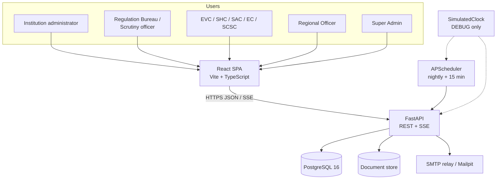
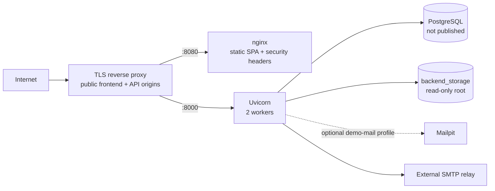
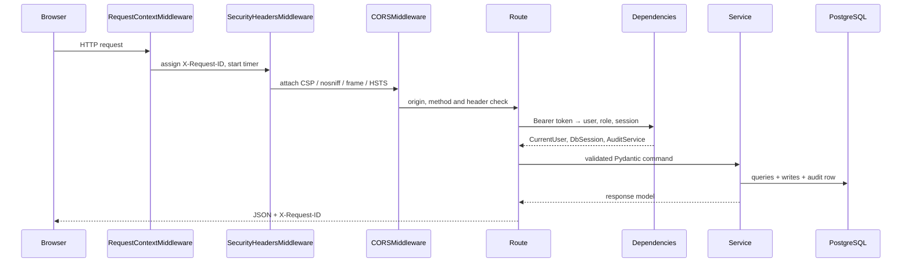
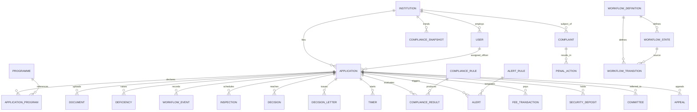
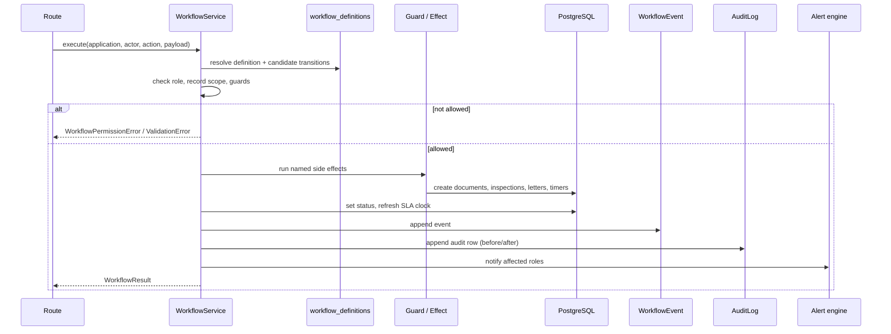
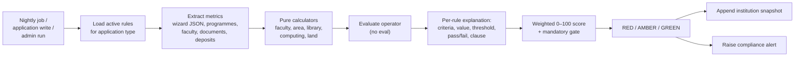
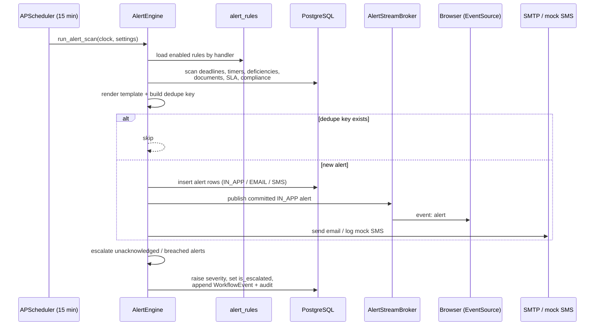

# Architecture

The system is a single-page React application over a FastAPI service, backed by PostgreSQL and an
in-process APScheduler. It is deliberately a **modular monolith**: one deployable API, one database,
one scheduler, with module boundaries that follow the APH domain rather than technical layers.

> Domain authority is `docs/reference/APH_SPEC.md`. Every rule, fee, document requirement, workflow
> edge and alert rule carries an `apH_clause`, or is explicitly flagged `needs_verification` and
> tracked in `docs/OPEN_QUESTIONS.md`.

## 1. Design principles

1. **The workflow is data.** States, transitions, allowed roles, guards and side effects live in
   `workflow_definitions`, `workflow_states` and `workflow_transitions`. `WorkflowService` only
   interprets rows.
2. **Business rules are data.** Compliance thresholds, SLA durations, fee tables, alert templates
   and required-document checklists are database rows, editable from admin screens.
3. **One write path.** Every state change goes through `WorkflowService`; every write writes an
   `AuditLog` in the same transaction.
4. **Explain every decision.** Compliance and eligibility results return the criteria, observed
   value, threshold, pass/fail and clause.
5. **Pure calculators.** Faculty, area, library, fee and penalty arithmetic are side-effect-free
   functions with worked-example tests.
6. **No hidden infrastructure.** No Redis, Celery or external queue. The scheduler is a thread in
   the API process.

## 2. System context



The `SimulatedClock` is process-local. In DEBUG mode `/dev/simulate-time` advances it so the demo can
show deadline breaches and escalation in seconds. In production the clock is real time and the
`/dev` router is not mounted.

## 3. Containers and deployment

### Development (`docker-compose.yml`)

| Service | Role | Host port |
| --- | --- | --- |
| `postgres` | PostgreSQL 16, named volume | 5432 |
| `mailpit` | SMTP + web inbox | 1025 / 8025 |
| `backend` | Uvicorn with `--reload`, source bind-mount | 8000 |
| `frontend` | Vite dev server with HMR | 5173 |

The backend runs `alembic upgrade head` on start. `make seed` loads the demo dataset;
`make reset-demo` drops the `public` schema, re-runs migrations and re-seeds.

### Production (`docker-compose.prod.yml`)



Differences from development:

- The frontend is built once and served by nginx; there is no Vite process.
- `DEBUG`, `DEMO_MODE` and `ENVIRONMENT=production` are forced; unsafe combinations fail startup.
- The backend filesystem is read-only apart from `/tmp` (tmpfs) and the storage volume.
- Database and SMTP ports are not published.
- `SECRET_KEY`, `POSTGRES_PASSWORD`, `CORS_ORIGINS` and `VITE_API_URL` are required.
- Containers run with `no-new-privileges`.

See `docs/SECURITY.md` for the production checklist and residual risks.

## 4. Backend structure

```
backend/app
├── api/
│   ├── dependencies.py      auth, role dependencies, clock, audit, DB session
│   ├── router.py            one place that mounts every router
│   └── routes/              thin HTTP adapters, one module per area
├── core/
│   ├── clock.py             real and simulated clocks
│   ├── config.py            Pydantic settings + production validators
│   ├── logging.py           JSON logs with request id
│   ├── middleware.py        request context + security headers
│   ├── rate_limit.py        in-process login limiter
│   └── security.py          bcrypt + JWT
├── db/                      engine, session factory, base/mixins
├── models/                  SQLAlchemy 2.x models, one file per aggregate
├── schemas/                 Pydantic v2 request/response models
├── services/                domain logic (see below)
├── templates/letters/       decision-letter templates
└── main.py                  application factory
```

### Request lifecycle



Routes do not contain business rules. A route validates the payload, checks the role, calls one
service and maps errors. Errors raised by services are translated by handlers in `main.py`
(`WorkspaceError`, `DocumentReviewError`, `WorkflowError`, `FeeError`).

### Service map

| Service | Responsibility |
| --- | --- |
| `workflow.py` | Load and execute the data-driven state machine; single status write path |
| `workflow_guards.py` | Named guards (`role`, scope, evidence, fee, deposits) |
| `workflow_effects.py` | Named side effects (assign officer, create inspection, issue letter, start clocks) |
| `workflow_jobs.py` | Automatic steps and the periodic clock sweep |
| `workflow_catalogue.py` | Workflow definition loader and integrity checks |
| `compliance.py` | Rule evaluation, metric extraction, weighted score, snapshots, nightly run |
| `compliance_calculators.py` | Pure APH calculators (faculty, area, library, computing, land) |
| `compliance_admin.py` | Rule CRUD, impact preview, config and monitor APIs |
| `alert_engine.py` | Rule evaluation, dedupe, channel delivery, acknowledgement, escalation |
| `alert_triggers.py` | Trigger catalogue and rule lookup |
| `alert_stream.py` | In-process SSE broker for alerts and simulated time |
| `deadlines.py` | `DeadlineService`: one place that resolves events and creates timers |
| `authorization.py` | Role and region scoping for applications, institutions and audit rows |
| `regions.py` | Matches a user region against either the legacy city or canonical AICTE region |
| `application_workspace.py` | Drafts, sections, programmes, uploads, submission, re-upload |
| `document_review.py` | Reviewer rejection, verification, compliance-window transitions |
| `document_verification.py` | Content-based document checks, certificate validity |
| `fee_calculator.py` | Pure APH fee arithmetic in integer paise |
| `fees.py` | Fee schedule lookup, transactions, Security Deposit quote and exemption |
| `committee.py` | Committee selection, conflict rules, quorum |
| `complaints.py` | Complaint intake and SCSC/SHC/EC path |
| `penal_actions.py` | APH 7.3/7.4 action suggestions and consequences |
| `deposit_release.py` | Clearance and release of the Security Deposit |
| `decision_letters.py` | LoA/LoD/LoR/Speaking Order generation |
| `deficiency_report.py` | Deficiency Report PDF |
| `reports.py` | SQL aggregate dashboards and application report |
| `audit.py` | Append-only audit writes |
| `scheduler.py` | APScheduler jobs |

## 5. Data model



Key modelling choices:

- Money is `BigInteger` **paise** everywhere; no floats.
- Application wizard data is JSONB; Pydantic schemas validate each section at the boundary.
- `documents` keeps one row per version with `supersedes_id`, plus `expiry_date` and
  `valid_until` kept in sync.
- Configuration tables (`compliance_rules`, `workflow_transitions`, `fee_schedules`,
  `alert_rules`, `required_documents`) carry `apH_clause` and `needs_verification`.
- `audit_logs` and `workflow_events` are append-only by convention and API design.

The full ER diagram lives in `docs/er-diagram.md`.

## 6. Workflow engine



The engine never executes code named by a database row directly: `side_effects` and `guards` hold
**names** resolved through a registry in `workflow_effects.py` / `workflow_guards.py`. A malicious
row can disable or reorder an edge, but it cannot inject Python.

## 7. Compliance engine



Rules are rows in `compliance_rules` with a metric expression, operator, threshold, severity,
`mandatory` and `illustrative` flags. A failed or unassessed **mandatory** rule prevents a Nil
Deficiency result; illustrative `DEMO-*` rules are advisory and always badged in the UI.

## 8. Alert and escalation engine



Escalation is an overlay: the application keeps its workflow status while `is_escalated` is set and
an `escalate` event records the chain step. Acknowledging an alert stops further escalation for
that alert.

## 9. Frontend

```
frontend/src
├── auth/            token storage, AuthContext, protected routes
├── components/      shell, dashboards, application wizard, case file, documents, UI primitives
├── lib/             API client, query keys, formatting, recent items
└── pages/           route-level screens
```

- React 18 + TypeScript + Vite, React Router 7, TanStack Query 5, Tailwind 4, Recharts.
- The API client wraps `fetch`, attaches the Bearer token and normalises errors.
- TanStack Query owns server state; cache invalidation happens after mutations.
- The alert bell subscribes to `/alerts/stream` with `EventSource` and invalidates alert queries on
  `alert` and `time` events.
- Role-specific navigation is derived from the logged-in profile; the API remains the authority.
- The design system is token-driven and showcased at `/dev/ui`.

## 10. Performance

Target: seeded dashboards answer in **under 500 ms**. `backend/tests/test_performance.py` asserts
the fastest of three warm calls for the regional, Regulation Bureau and institution dashboards, the
application list and the alert inbox.

Controls:

- SQL aggregates in `services/reports.py` (no Python-side scans of whole tables).
- Pagination on every list endpoint (`page`, `page_size`, capped at 100).
- Composite indexes from migration `0026_performance_indexes`:
  - `applications(academic_year, status)`
  - `applications(track, status)`
  - `institutions(state)`
  - `alerts(recipient_user_id, channel, created_at DESC)`
  - `documents(expiry_date)` partial where not null
  - `deficiencies(status, due_date)`
- `selectinload`/`joinedload` on the read paths that need relationships.
- Eager-loaded rule relationships when rendering alerts, avoiding N+1 queries in the scan.

The migration also backfills `documents.expiry_date` from `valid_until` so the document-expiry scan
sees uploads created before the two fields were synchronised.

## 11. Testing strategy

| Layer | What is covered | Where |
| --- | --- | --- |
| Unit | Calculators, fee arithmetic, deadline math, security helpers | `backend/tests/test_fee_calculator.py`, `test_deadlines.py`, `test_rate_limit.py` |
| Service | Workflow guards/effects, compliance evaluation, alert triggers and dedupe | `test_workflow.py`, `test_compliance_engine.py`, `test_alert_engine.py` |
| API | Role denial, tenant isolation, pagination, validation, headers, rate limit | `test_auth.py`, `test_authorization.py`, `test_security_hardening.py`, `test_performance.py` |
| Configuration | Every rule/transition/fee/alert row has a clause or `needs_verification` | `test_aph_configuration.py` |
| End-to-end | Login, submit application, officer action, document re-upload, live alert | `frontend/e2e/*.spec.ts` (Playwright) |

`make coverage` enforces 80% on workflow, compliance, alerts, fee calculator and auth.

## 12. Trade-offs and known gaps

- **Single process scheduler.** Simple to run and demo, but a multi-replica deployment needs a
  leader election or an external scheduler. Documented in `docs/ROADMAP.md`.
- **In-process rate limiter and SSE broker.** Both assume one API process. Redis is the planned
  shared backend.
- **Committee-wide reads.** Committees can read all referred cases until membership is modelled per
  case (OQ in `docs/OPEN_QUESTIONS.md`).
- **Regional aggregate report is national.** Only the application list is region-scoped (OQ-75).
- **Scenario compliance scores reflect partial seed data** (OQ-76).
- **No durable notification retry.** Email is best-effort SMTP; the in-app row is the source of
  truth.
- **No ML risk scoring yet.** The roadmap keeps it out of the MVP scope.
