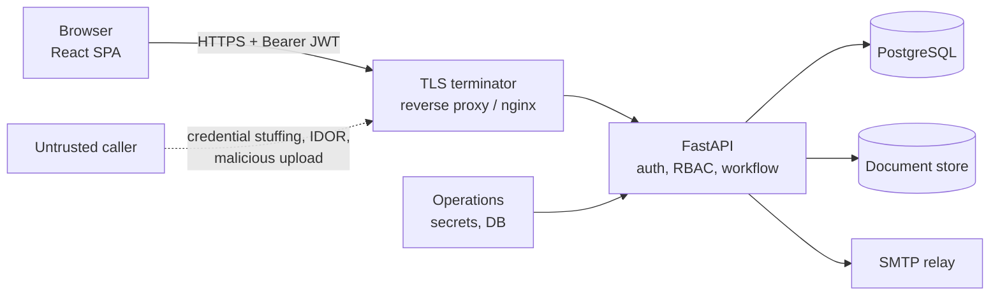

# Security architecture and threat model

This document describes the security controls that ship with the prototype, the assets they
protect, the threats considered, and the residual risks that must be closed before a real AICTE
deployment. It is deliberately concrete: every control names the code that implements it and the
test that covers it.

> **Scope.** The prototype handles fictional institutions and illustrative norms. It has not been
> penetration-tested, does not process real personal data, and is not certified against any
> government security standard. Treat this as a hardening baseline, not an accreditation.

## 1. Assets and trust boundaries

| Asset | Why it matters | Where it lives |
| --- | --- | --- |
| Credentials and JWT signing key | Account takeover, forged decisions | Environment variables, bcrypt hashes in `users` |
| Application and institution records | Personal and commercial data, statutory decisions | PostgreSQL |
| Uploaded documents | Certificates, affidavits, financial evidence | `STORAGE_DIR`, UUID-named files |
| Audit trail | Non-repudiation of every write and state change | `audit_logs` (append-only) |
| Workflow and compliance configuration | A tampered rule changes approval outcomes | Seeded DB rows (`compliance_rules`, `workflow_transitions`, `fee_schedules`, `alert_rules`) |
| Outbound email | Phishing or spam if abused | SMTP relay / Mailpit |



Trust boundaries:

1. **Browser → API.** Everything from the browser is untrusted, including the JWT, query
   parameters, JSON bodies and uploaded bytes.
2. **API → database.** The API is the only writer. SQL is generated through SQLAlchemy; raw SQL is
   limited to migrations and a single quoted column name.
3. **API → document store.** Files are written with random names and are never served from a
   user-controlled path.
4. **API → SMTP.** Recipient addresses come from database users, not from request bodies.
5. **Operator → runtime.** Secrets and production flags are environment variables, validated at
   startup.

## 2. Threat model

| # | Threat | Impact | Control | Residual risk |
| --- | --- | --- | --- | --- |
| T1 | Credential stuffing / password spraying | Account takeover | Sliding-window failure limiter keyed by `client-ip / email` (`app/core/rate_limit.py`), bcrypt cost 12, generic `Invalid email or password`, `429` with `Retry-After` | Limiter is per process (see §6) |
| T2 | Stolen or replayed JWT | Impersonation | Signed HS256 token with `exp`, `iat`, `sub`, `type=access`; expiry configurable (8 h dev, 60 min prod); user re-loaded and `is_active` checked on every request (`app/api/dependencies.py`) | Token stored in `localStorage`; an XSS would expose it |
| T3 | Privilege escalation / IDOR | Cross-tenant reads or illegal decisions | `require_roles` on every route; SQL scoping in `authorization.application_scope` / `institution_scope` / `audit_log_scope`; all status changes go through the data-driven workflow state machine | Committee-wide read roles intentionally see all referred cases |
| T4 | Illegal workflow transition | Approval without scrutiny or decision | Single `WorkflowService`; role, record scope, guards and named effects are checked before status changes; no endpoint assigns `Application.status` | A `SUPER_ADMIN` can edit configuration rows (by design) |
| T5 | Malicious upload | Malware, stored XSS, path traversal | 10 MB cap, magic-byte type detection (PDF/JPEG/PNG only), extension forced from detected type, random UUID storage name, display name stripped to safe characters (`application_workspace.py`) | No antivirus scan |
| T6 | SQL injection | Data breach | SQLAlchemy ORM and bound parameters throughout; the compliance expression engine never calls `eval()` | Raw SQL in migrations is trusted code |
| T7 | XSS / clickjacking | Session theft, UI redress | API middleware sets CSP, `X-Frame-Options: DENY`, `nosniff`, Referrer-Policy, Permissions-Policy; nginx sets the same for the SPA | `style-src 'unsafe-inline'` is required by the current CSS pipeline |
| T8 | CSRF | Forged writes | Auth uses an `Authorization: Bearer` header, not a cookie; CORS allows only explicit origins, methods and headers | None for the token flow; revisit if cookies are introduced |
| T9 | Secret leakage | Full compromise | `.env*` ignored except examples; `SecretStr` settings; production validator rejects the development secret, `DEBUG=true`, `DEMO_MODE=true` and `localhost` CORS origins (`app/core/config.py`) | Secrets are visible to the container runtime, as usual |
| T10 | Audit tampering | Loss of non-repudiation | `AuditService` writes actor, action, entity, before/after JSON and IP in the same transaction as the change; there is no update/delete API | A database superuser can still alter rows |
| T11 | Enumeration of accounts | Reconnaissance | Same error and timing path for unknown email and wrong password (`authenticate_user`); login failures logged without the password | Response timing is not constant-time across all failure modes |
| T12 | Abuse of outbound notifications | Spam / phishing | Recipients are resolved from `users` and alert rules, never from request bodies; SMS is a logging mock | SMTP relay trust is an operational control |
| T13 | Demo endpoints in production | Time travel, data reset | `/dev/*` is mounted only when `DEBUG=true`; production validator forces `DEBUG=false` | Compose flags must be set correctly |
| T14 | Dependency vulnerability | RCE / data leak | Pinned requirements and lockfiles; `pip-audit`/`npm audit` are roadmap items | No automated SCA gate yet |

## 3. Authentication and session controls

- Passwords are bcrypt hashes with cost 12 and a minimum length of 8
  (`app/core/security.py`).
- Access tokens are JWTs with `sub`, `role`, `institution_id`, `type`, `iat` and `exp`. The API
  rejects wrong signature, expiry, missing required claims and non-access token types.
- The token lifetime is `ACCESS_TOKEN_EXPIRE_MINUTES` (default 480 in development, 60 in the
  production example).
- There is no refresh token. A user signs in again when the token expires.
- `/auth/*` responses are `Cache-Control: no-store`.
- Login throttling defaults: 5 failures in 300 s → 900 s block, configurable through
  `LOGIN_RATE_LIMIT_*`. A blocked attempt writes an `auth.rate_limited` audit row and returns
  `429` with `Retry-After`.
- The limiter stores only `client-ip|email` keys and timestamps; it never stores the attempted
  password.

Production note: put the API behind a proxy that sets `X-Forwarded-Proto` and run with
`--proxy-headers --forwarded-allow-ips=<proxy>`. HSTS is emitted only when the request is already
HTTPS, so plain-HTTP local runs are not poisoned.

## 4. Authorization and the RBAC matrix

Roles are defined in `app/models/enums.py`. Route-level role checks live in the route modules;
record-level scoping lives in `app/services/authorization.py`.

Legend: **R** read · **W** write · **own** own institution · **rgn** own AICTE region ·
**asgn** assigned/referred cases · **–** no access.

| Capability | Institution admin | Regulation Bureau | Scrutiny | EVC | Regional Officer | SHC | SAC | EC | SCSC | Super Admin |
| --- | --- | --- | --- | --- | --- | --- | --- | --- | --- | --- |
| Sign in, read own profile | W | W | W | W | W | W | W | W | W | W |
| Create / edit / submit own application | W(own) | – | – | – | – | – | – | – | – | W |
| Upload / replace own documents | W(own) | – | – | – | – | – | – | – | – | W |
| Read applications | R(own) | R(rgn) | R(asgn+rgn) | R(asgn) | R(rgn) | R | R | R | R | R |
| Verify / reject documents | – | W | W | – | – | – | – | – | – | W |
| Scrutiny, deficiency, re-scrutiny | – | W | W(asgn) | – | – | – | – | – | – | W |
| EVC report | – | – | – | W(asgn) | – | – | – | – | – | W |
| Inspection scheduling / committee referral | – | – | – | – | W(rgn) | – | – | – | – | W |
| SHC / SAC hearings and appeals | – | – | – | – | – | W | W | – | – | W |
| EC decision | – | – | – | – | – | – | – | W | – | W |
| Complaints / penal actions | W(own file) | R | – | – | R(rgn) | W | W | W | W | W |
| Security deposits | W(own request) | – | – | – | W(clearance) | – | – | W(release) | – | W |
| Compliance rules and monitor | – | – | – | – | W | – | – | – | – | W |
| Alert rules | – | – | – | – | – | – | – | – | – | W |
| Reports / dashboards | R(own) | R | R | – | R(rgn) | – | – | – | – | R |
| Audit logs | – | R(rgn) | – | – | R(rgn) | – | – | – | – | R |
| Workflow / alert configuration | – | – | – | – | – | – | – | – | – | W |

Two deliberate exceptions:

- SHC, SAC, EC and SCSC members can read every case referred to their committee because committee
  membership is not yet linked to individual cases. Writes are still governed by workflow
  transitions.
- A `REGULATION_BUREAU_OFFICER` with no `region` sees all regions; this is the national Bureau
  account used in the demo. Production should require a region or an explicit national flag.

## 5. Audit trail

Every write action and state change calls `AuditService.log` inside the same transaction as the
change:

| Field | Meaning |
| --- | --- |
| `actor_id` | User who performed the action (`SET NULL` if the user is deleted) |
| `action` | Stable event name, e.g. `auth.login`, `auth.rate_limited`, `workflow.transition`, `document.reupload` |
| `entity_type` / `entity_id` | Target record |
| `before` / `after` | JSON snapshots, including status, decision, rejection reason or delivery details |
| `ip` | Client IP, truncated to 45 characters |
| `created_at` | UTC timestamp |

The trail is append-only at the application layer: there is no update or delete endpoint. The audit
API is restricted to `SUPER_ADMIN`, `REGIONAL_OFFICER` and `REGULATION_BUREAU_OFFICER`, and scoped
by `audit_log_scope`. The login path audits success, failure and throttling without persisting the
password. Workflow transitions write both an `audit_logs` row and a `workflow_events` row.

Production recommendation: stream audit rows to append-only storage (WORM bucket or SIEM) and
restrict database `UPDATE`/`DELETE` on `audit_logs` to a break-glass role.

## 6. Known limitations

| Limitation | Impact | Planned fix |
| --- | --- | --- |
| Login limiter is in process memory | A multi-worker or multi-host deployment multiplies the effective attempt budget; a restart clears blocks | Move counters to Redis (`ROADMAP.md`, P1) |
| JWT is stored in `localStorage` | Any XSS can read it | Move to an HttpOnly, `SameSite=Strict` cookie with CSRF protection, or a BFF |
| SSE passes the token as a query parameter | Tokens can appear in proxy/access logs | Short-lived stream ticket or cookie auth |
| No refresh-token rotation | Long sessions or repeated sign-in | Add refresh tokens with rotation and reuse detection |
| No antivirus / content disarm | A valid PDF may still carry malware | Add ClamAV or an external scanning service |
| No MFA | A stolen password is enough | TOTP/WebAuthn for officers and admins |
| No account lockout review workflow | Determined attacker can retry after the block | Alert on repeated `auth.rate_limited`, add CAPTCHA or IP reputation |
| No SCA gate | Vulnerable dependency can ship | `pip-audit`, `npm audit`, Dependabot in CI |
| Frontend CSP allows inline styles | Weakens XSS defence | Adopt a nonce/hash-based style pipeline |
| Audit rows are mutable by a DB superuser | Non-repudiation depends on DB controls | Database role separation + WORM export |

## 7. Production hardening checklist

- [ ] Generate `SECRET_KEY` with `python3 -c "import secrets; print(secrets.token_urlsafe(48))"`.
- [ ] Set `ENVIRONMENT=production`, `DEBUG=false`, `DEMO_MODE=false`; the app refuses to start
      otherwise.
- [ ] Set `CORS_ORIGINS` to the exact public frontend origin (HTTPS, no trailing slash, no
      wildcard, no localhost).
- [ ] Terminate TLS at a proxy and forward `X-Forwarded-Proto: https`; keep HSTS enabled.
- [ ] Use a dedicated database role with only the privileges the app needs; do not publish the
      PostgreSQL port.
- [ ] Point `SMTP_HOST` at an authenticated relay; do not start the `demo-mail` profile.
- [ ] Set `WEB_CONCURRENCY` conservatively and put a shared limiter in front until Redis lands.
- [ ] Mount the document volume with `noexec`, `nosuid`, `nodev`.
- [ ] Back up `audit_logs` and the document store; test a restore.
- [ ] Rotate the seeded demo passwords or delete the demo users before any real use.
- [ ] Run `make test`, `make coverage`, `make e2e` and `docker compose -f
      docker-compose.prod.yml config` before release.

The production Compose profile (`docker-compose.prod.yml`) already runs the backend read-only with
a `/tmp` tmpfs and `no-new-privileges`, serves the SPA from nginx, does not publish database or
SMTP ports, and forces the three production flags.

## 8. Verifying the controls

```bash
make test          # full backend suite
make coverage      # 80% gate on workflow, compliance, alerts, calculators and auth
make e2e           # Playwright smoke tests, including auth rejection and live alerts
```

Focused security tests:

```bash
docker compose exec backend pytest -q tests/test_security_hardening.py tests/test_rate_limit.py
docker compose exec backend pytest -q tests/test_authorization.py tests/test_audit_logs.py
```

A build-failing test in `backend/tests/test_aph_configuration.py` also requires every
`ComplianceRule`, `WorkflowTransition`, `FeeSchedule` and `AlertRule` row to carry an `apH_clause`
(or `needs_verification=true`), so a configuration change cannot silently lose its legal basis.
