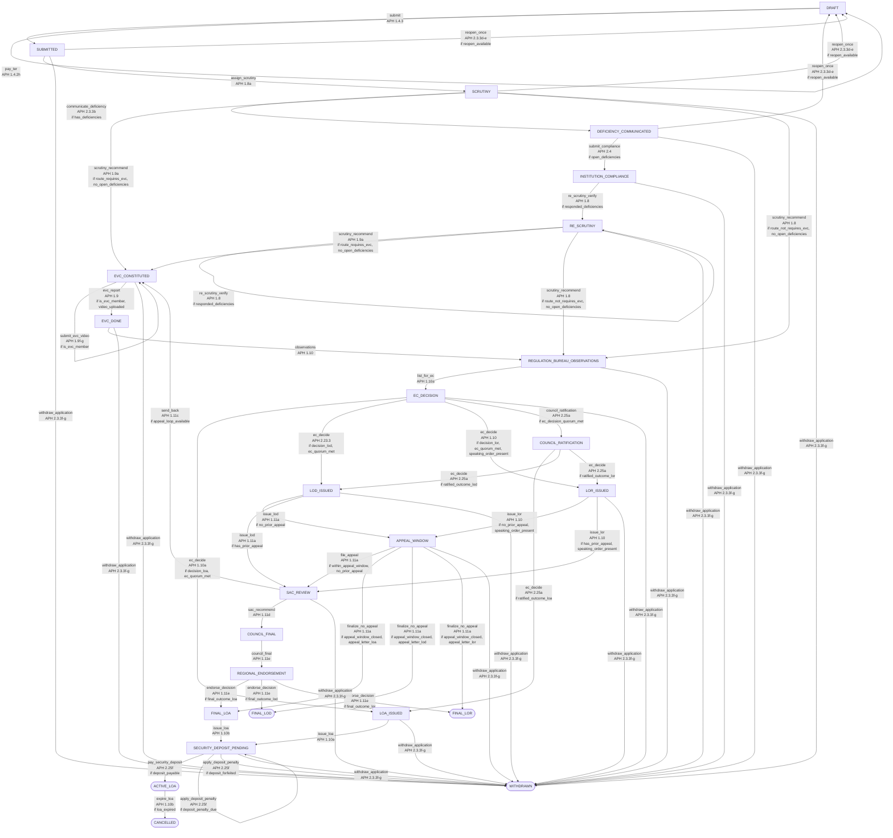
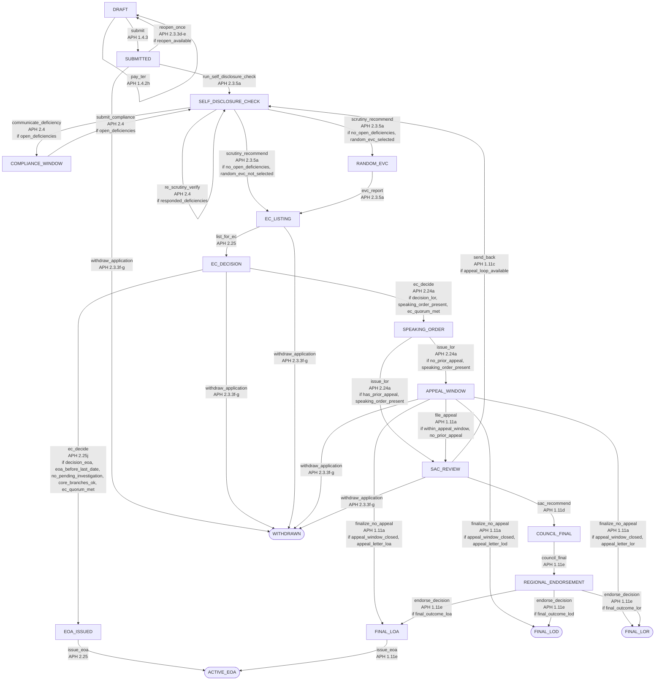
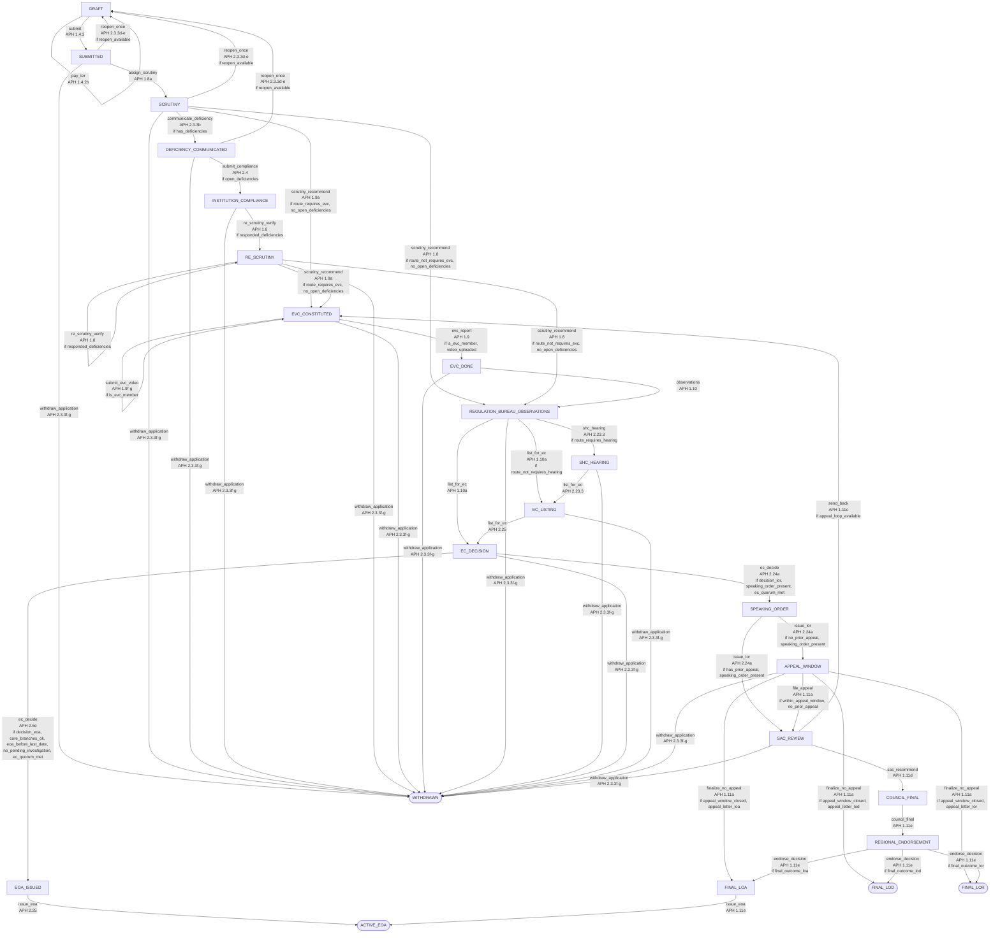
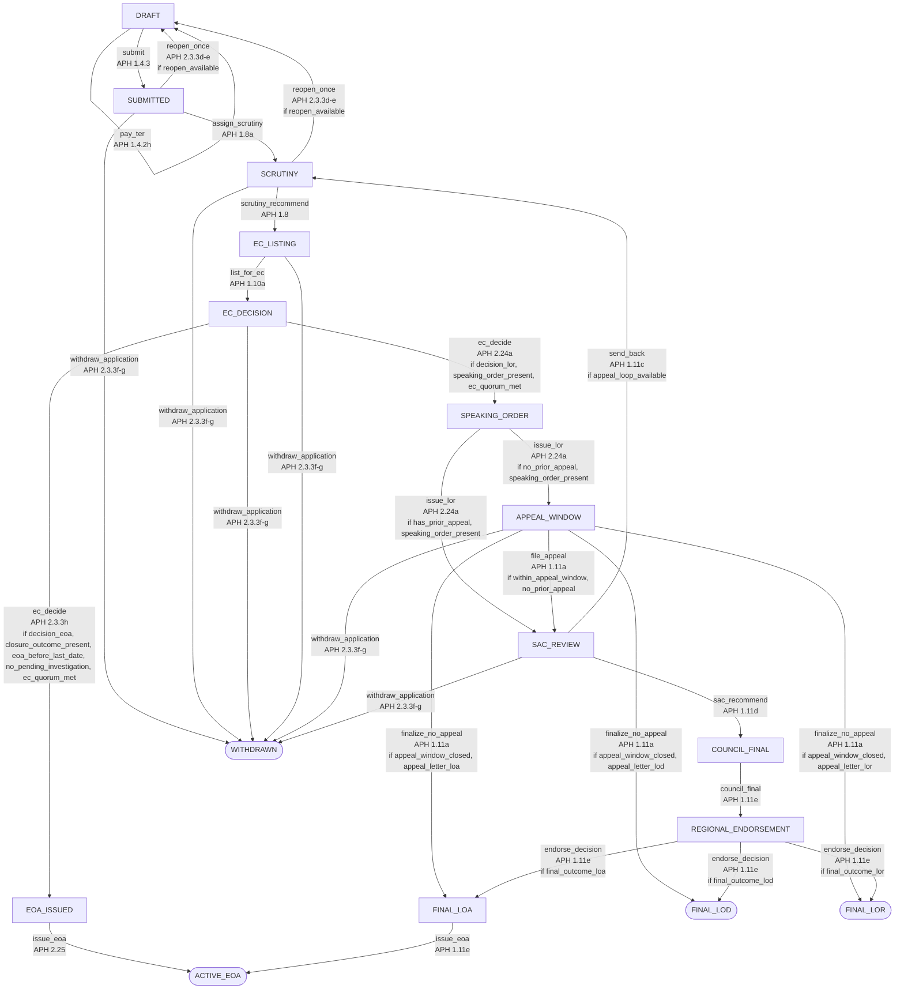

# APH workflow — data-driven state machine

This document is rendered from `backend/seeds/aph/workflow_definitions.json` by
`python scripts/render_workflow_docs.py`. The running API reads the same rows
through `GET /workflow/definition?type=…` and `GET /workflow/diagram`; the case
file must render its stages from that endpoint rather than from a hard-coded array
(APH Annexure-7).

Every state and every edge carries an APH clause. Rows marked
`needs_verification = true` in the seed data are listed in
`docs/OPEN_QUESTIONS.md`. All sample institutions are fictional and all
thresholds, dates and fees are illustrative.

## How the engine works

1. `workflow_definitions` selects the track; `application_type_routes` decides
   which track an application type follows.
2. `workflow_transitions` is the only source of legal `(state, action, role)`
   combinations. Edges are tried by `priority`; a guard that fails falls through to
   the next edge, which is how the four `ec_decide` outcomes and the EVC / no-EVC
   branches are expressed.
3. Named guards live in `app/services/workflow_guards.py`; named side effects live
   in `app/services/workflow_effects.py`. A guard or effect name that is not
   registered fails loudly at runtime and in `tests/test_aph_configuration.py`.
4. Every action writes exactly one `WorkflowEvent` (carrying the edge's APH clause)
   and one `AuditLog` row in the same transaction.

## Automatic clock steps

`app/services/workflow_jobs.py` advances two steps without a human when the
periodic alert scan runs:

* `finalize_no_appeal` — an LoD/LoR decision becomes final when the seven-day
  appeal window closes with no appeal (APH 1.11a).
* `expire_loa` — an LoA lapses at the end of its two academic years and the
  approval is cancelled (APH 1.10b).

## Track parameters

Track behaviour that APH leaves open is stored in `workflow_definitions.config`
as editable JSON: `appeal_start_event`, `security_deposit`,
`random_evc_percent` and `core_branches_required`. The appeal start event and the
Security Deposit ladder also live in `deadline_rules`, so an administrator can
change them without a deployment.

## TRACK_A — Track A - Chapter I approval and extension

Track A is the Chapter I cycle for a new technical institution and for an Extension of Approval filed with a Self-Disclosure. Submitting locks the file; Scrutiny may raise deficiencies; the Expert Visit Committee (EVC) records a visit video and a report; the Regulation Bureau adds observations and lists the case before the Executive Committee (EC). An approval issues an LoA and starts the Security Deposit clock; a rejection or Letter of Deficiency issues a Speaking Order and opens the single seven-day appeal window.

Config: `{"appeal_start_event": "DECISION_UPLOADED", "security_deposit": true}`

### Diagram

### States

| State | Stage | Initial | Terminal | APH clause |
| --- | --- | --- | --- | --- |
| DRAFT | APPLICATION | yes |  | APH 1.4 |
| SUBMITTED | APPLICATION |  |  | APH 1.4.3 |
| SCRUTINY | SCRUTINY |  |  | APH 1.8 |
| DEFICIENCY_COMMUNICATED | DEFICIENCY |  |  | APH 2.3.3b |
| INSTITUTION_COMPLIANCE | DEFICIENCY |  |  | APH 2.4 |
| RE_SCRUTINY | SCRUTINY |  |  | APH 1.8 |
| EVC_CONSTITUTED | INSPECTION |  |  | APH 1.9a |
| EVC_DONE | INSPECTION |  |  | APH 1.9 |
| REGULATION_BUREAU_OBSERVATIONS | COMMITTEE_REVIEW |  |  | APH 1.10 |
| EC_DECISION | DECISION |  |  | APH 1.10a |
| COUNCIL_RATIFICATION | DECISION |  |  | APH 2.25a |
| LOA_ISSUED | DECISION |  |  | APH 1.10a |
| LOD_ISSUED | DECISION |  |  | APH 2.23.3 |
| LOR_ISSUED | DECISION |  |  | APH 1.10 |
| APPEAL_WINDOW | DECISION |  |  | APH 1.11a |
| SAC_REVIEW | COMMITTEE_REVIEW |  |  | APH 1.11c |
| COUNCIL_FINAL | DECISION |  |  | APH 1.11e |
| REGIONAL_ENDORSEMENT | COMMITTEE_REVIEW |  |  | APH 1.11e |
| FINAL_LOA | COMPLETED |  |  | APH 1.10b |
| FINAL_LOD | COMPLETED |  | yes | APH 1.11e |
| FINAL_LOR | COMPLETED |  | yes | APH 1.11e |
| SECURITY_DEPOSIT_PENDING | DECISION |  |  | APH 2.25f |
| ACTIVE_LOA | COMPLETED |  | yes | APH 1.10b |
| CANCELLED | COMPLETED |  | yes | APH 1.10b |
| WITHDRAWN | COMPLETED |  | yes | APH 2.3.3f-g |

### Transitions

| From | Action | To | Roles | Guards | APH clause |
| --- | --- | --- | --- | --- | --- |
| DRAFT | submit | SUBMITTED | INSTITUTION_ADMIN | — | APH 1.4.3 |
| DRAFT | pay_ter | DRAFT | INSTITUTION_ADMIN | — | APH 1.4.2h |
| SUBMITTED | assign_scrutiny | SCRUTINY | REGULATION_BUREAU_OFFICER | — | APH 1.8a |
| SCRUTINY | communicate_deficiency | DEFICIENCY_COMMUNICATED | SCRUTINY_COMMITTEE_MEMBER | has_deficiencies | APH 2.3.3b |
| SCRUTINY | scrutiny_recommend | EVC_CONSTITUTED | SCRUTINY_COMMITTEE_MEMBER | route_requires_evc, no_open_deficiencies | APH 1.9a |
| SCRUTINY | scrutiny_recommend | REGULATION_BUREAU_OBSERVATIONS | SCRUTINY_COMMITTEE_MEMBER | route_not_requires_evc, no_open_deficiencies | APH 1.8 |
| DEFICIENCY_COMMUNICATED | submit_compliance | INSTITUTION_COMPLIANCE | INSTITUTION_ADMIN | open_deficiencies | APH 2.4 |
| INSTITUTION_COMPLIANCE | re_scrutiny_verify | RE_SCRUTINY | SCRUTINY_COMMITTEE_MEMBER | responded_deficiencies | APH 1.8 |
| RE_SCRUTINY | re_scrutiny_verify | RE_SCRUTINY | SCRUTINY_COMMITTEE_MEMBER | responded_deficiencies | APH 1.8 |
| RE_SCRUTINY | scrutiny_recommend | EVC_CONSTITUTED | SCRUTINY_COMMITTEE_MEMBER | route_requires_evc, no_open_deficiencies | APH 1.9a |
| RE_SCRUTINY | scrutiny_recommend | REGULATION_BUREAU_OBSERVATIONS | SCRUTINY_COMMITTEE_MEMBER | route_not_requires_evc, no_open_deficiencies | APH 1.8 |
| EVC_CONSTITUTED | submit_evc_video | EVC_CONSTITUTED | EVC_MEMBER | is_evc_member | APH 1.9f-g |
| EVC_CONSTITUTED | evc_report | EVC_DONE | EVC_MEMBER | is_evc_member, video_uploaded | APH 1.9 |
| EVC_DONE | observations | REGULATION_BUREAU_OBSERVATIONS | REGULATION_BUREAU_OFFICER | — | APH 1.10 |
| REGULATION_BUREAU_OBSERVATIONS | list_for_ec | EC_DECISION | REGULATION_BUREAU_OFFICER | — | APH 1.10a |
| EC_DECISION | ec_decide | LOA_ISSUED | EXECUTIVE_COMMITTEE_MEMBER | decision_loa, ec_quorum_met | APH 1.10a |
| EC_DECISION | ec_decide | LOD_ISSUED | EXECUTIVE_COMMITTEE_MEMBER | decision_lod, ec_quorum_met | APH 2.23.3 |
| EC_DECISION | ec_decide | LOR_ISSUED | EXECUTIVE_COMMITTEE_MEMBER | decision_lor, ec_quorum_met, speaking_order_present | APH 1.10 |
| EC_DECISION | council_ratification | COUNCIL_RATIFICATION | SUPER_ADMIN | ec_decision_quorum_met | APH 2.25a |
| LOA_ISSUED | issue_loa | SECURITY_DEPOSIT_PENDING | EXECUTIVE_COMMITTEE_MEMBER | — | APH 1.10a |
| LOD_ISSUED | issue_lod | APPEAL_WINDOW | EXECUTIVE_COMMITTEE_MEMBER | no_prior_appeal | APH 1.11a |
| LOD_ISSUED | issue_lod | SAC_REVIEW | EXECUTIVE_COMMITTEE_MEMBER | has_prior_appeal | APH 1.11a |
| LOR_ISSUED | issue_lor | APPEAL_WINDOW | EXECUTIVE_COMMITTEE_MEMBER | no_prior_appeal, speaking_order_present | APH 1.10 |
| LOR_ISSUED | issue_lor | SAC_REVIEW | EXECUTIVE_COMMITTEE_MEMBER | has_prior_appeal, speaking_order_present | APH 1.10 |
| COUNCIL_RATIFICATION | ec_decide | LOA_ISSUED | EXECUTIVE_COMMITTEE_MEMBER | ratified_outcome_loa | APH 2.25a |
| COUNCIL_RATIFICATION | ec_decide | LOD_ISSUED | EXECUTIVE_COMMITTEE_MEMBER | ratified_outcome_lod | APH 2.25a |
| COUNCIL_RATIFICATION | ec_decide | LOR_ISSUED | EXECUTIVE_COMMITTEE_MEMBER | ratified_outcome_lor | APH 2.25a |
| FINAL_LOA | issue_loa | SECURITY_DEPOSIT_PENDING | EXECUTIVE_COMMITTEE_MEMBER | — | APH 1.10b |
| APPEAL_WINDOW | file_appeal | SAC_REVIEW | INSTITUTION_ADMIN | within_appeal_window, no_prior_appeal | APH 1.11a |
| APPEAL_WINDOW | finalize_no_appeal | FINAL_LOA | REGULATION_BUREAU_OFFICER | appeal_window_closed, appeal_letter_loa | APH 1.11a |
| APPEAL_WINDOW | finalize_no_appeal | FINAL_LOD | REGULATION_BUREAU_OFFICER | appeal_window_closed, appeal_letter_lod | APH 1.11a |
| APPEAL_WINDOW | finalize_no_appeal | FINAL_LOR | REGULATION_BUREAU_OFFICER | appeal_window_closed, appeal_letter_lor | APH 1.11a |
| SAC_REVIEW | send_back | EVC_CONSTITUTED | SAC_MEMBER | appeal_loop_available | APH 1.11c |
| SAC_REVIEW | sac_recommend | COUNCIL_FINAL | SAC_MEMBER | — | APH 1.11d |
| COUNCIL_FINAL | council_final | REGIONAL_ENDORSEMENT | EXECUTIVE_COMMITTEE_MEMBER | — | APH 1.11e |
| REGIONAL_ENDORSEMENT | endorse_decision | FINAL_LOA | REGIONAL_OFFICER | final_outcome_loa | APH 1.11e |
| REGIONAL_ENDORSEMENT | endorse_decision | FINAL_LOD | REGIONAL_OFFICER | final_outcome_lod | APH 1.11e |
| REGIONAL_ENDORSEMENT | endorse_decision | FINAL_LOR | REGIONAL_OFFICER | final_outcome_lor | APH 1.11e |
| SECURITY_DEPOSIT_PENDING | pay_security_deposit | ACTIVE_LOA | INSTITUTION_ADMIN | deposit_payable | APH 2.25f |
| SECURITY_DEPOSIT_PENDING | apply_deposit_penalty | SECURITY_DEPOSIT_PENDING | REGULATION_BUREAU_OFFICER | deposit_penalty_due | APH 2.25f |
| SECURITY_DEPOSIT_PENDING | apply_deposit_penalty | WITHDRAWN | REGULATION_BUREAU_OFFICER | deposit_forfeited | APH 2.25f |
| ACTIVE_LOA | expire_loa | CANCELLED | REGULATION_BUREAU_OFFICER | loa_expired | APH 1.10b |
| SUBMITTED | reopen_once | DRAFT | REGULATION_BUREAU_OFFICER | reopen_available | APH 2.3.3d-e |
| SCRUTINY | reopen_once | DRAFT | REGULATION_BUREAU_OFFICER | reopen_available | APH 2.3.3d-e |
| DEFICIENCY_COMMUNICATED | reopen_once | DRAFT | REGULATION_BUREAU_OFFICER | reopen_available | APH 2.3.3d-e |
| SUBMITTED | withdraw_application | WITHDRAWN | INSTITUTION_ADMIN | — | APH 2.3.3f-g |
| SCRUTINY | withdraw_application | WITHDRAWN | INSTITUTION_ADMIN | — | APH 2.3.3f-g |
| DEFICIENCY_COMMUNICATED | withdraw_application | WITHDRAWN | INSTITUTION_ADMIN | — | APH 2.3.3f-g |
| INSTITUTION_COMPLIANCE | withdraw_application | WITHDRAWN | INSTITUTION_ADMIN | — | APH 2.3.3f-g |
| RE_SCRUTINY | withdraw_application | WITHDRAWN | INSTITUTION_ADMIN | — | APH 2.3.3f-g |
| EVC_CONSTITUTED | withdraw_application | WITHDRAWN | INSTITUTION_ADMIN | — | APH 2.3.3f-g |
| EVC_DONE | withdraw_application | WITHDRAWN | INSTITUTION_ADMIN | — | APH 2.3.3f-g |
| REGULATION_BUREAU_OBSERVATIONS | withdraw_application | WITHDRAWN | INSTITUTION_ADMIN | — | APH 2.3.3f-g |
| EC_DECISION | withdraw_application | WITHDRAWN | INSTITUTION_ADMIN | — | APH 2.3.3f-g |
| LOA_ISSUED | withdraw_application | WITHDRAWN | INSTITUTION_ADMIN | — | APH 2.3.3f-g |
| LOD_ISSUED | withdraw_application | WITHDRAWN | INSTITUTION_ADMIN | — | APH 2.3.3f-g |
| LOR_ISSUED | withdraw_application | WITHDRAWN | INSTITUTION_ADMIN | — | APH 2.3.3f-g |
| APPEAL_WINDOW | withdraw_application | WITHDRAWN | INSTITUTION_ADMIN | — | APH 2.3.3f-g |
| SAC_REVIEW | withdraw_application | WITHDRAWN | INSTITUTION_ADMIN | — | APH 2.3.3f-g |
| SECURITY_DEPOSIT_PENDING | withdraw_application | WITHDRAWN | INSTITUTION_ADMIN | — | APH 2.3.3f-g |

## TRACK_B — Track B - EoA by self-disclosure

Track B covers the self-disclosure types. The Regulation Bureau runs an automatic Deficiency Report (APH 2.3.5a); a Nil Deficiency clears the case, deficiencies open a compliance window, and a configurable percentage of cases is sampled for a random EVC. The EC then issues an EoA with the Approved Intake or a Speaking Order.

Config: `{"appeal_start_event": "DECISION_UPLOADED", "core_branches_required": 3, "random_evc_percent": 10, "security_deposit": false}`

### Diagram

### States

| State | Stage | Initial | Terminal | APH clause |
| --- | --- | --- | --- | --- |
| DRAFT | APPLICATION | yes |  | APH 1.4 |
| SUBMITTED | APPLICATION |  |  | APH 1.4.3 |
| SELF_DISCLOSURE_CHECK | SCRUTINY |  |  | APH 2.3.5a |
| COMPLIANCE_WINDOW | DEFICIENCY |  |  | APH 2.4 |
| RANDOM_EVC | INSPECTION |  |  | APH 2.3.5a |
| EC_LISTING | DECISION |  |  | APH 2.25 |
| EC_DECISION | DECISION |  |  | APH 1.10a |
| EOA_ISSUED | DECISION |  |  | APH 2.25 |
| ACTIVE_EOA | COMPLETED |  | yes | APH 2.25 |
| SPEAKING_ORDER | DECISION |  |  | APH 2.24a |
| APPEAL_WINDOW | DECISION |  |  | APH 1.11a |
| SAC_REVIEW | COMMITTEE_REVIEW |  |  | APH 1.11c |
| COUNCIL_FINAL | DECISION |  |  | APH 1.11e |
| REGIONAL_ENDORSEMENT | COMMITTEE_REVIEW |  |  | APH 1.11e |
| FINAL_LOA | COMPLETED |  |  | APH 1.10b |
| FINAL_LOD | COMPLETED |  | yes | APH 1.11e |
| FINAL_LOR | COMPLETED |  | yes | APH 1.11e |
| WITHDRAWN | COMPLETED |  | yes | APH 2.3.3f-g |

### Transitions

| From | Action | To | Roles | Guards | APH clause |
| --- | --- | --- | --- | --- | --- |
| DRAFT | submit | SUBMITTED | INSTITUTION_ADMIN | — | APH 1.4.3 |
| DRAFT | pay_ter | DRAFT | INSTITUTION_ADMIN | — | APH 1.4.2h |
| SUBMITTED | run_self_disclosure_check | SELF_DISCLOSURE_CHECK | REGULATION_BUREAU_OFFICER | — | APH 2.3.5a |
| SELF_DISCLOSURE_CHECK | communicate_deficiency | COMPLIANCE_WINDOW | REGULATION_BUREAU_OFFICER | open_deficiencies | APH 2.4 |
| COMPLIANCE_WINDOW | submit_compliance | SELF_DISCLOSURE_CHECK | INSTITUTION_ADMIN | open_deficiencies | APH 2.4 |
| SELF_DISCLOSURE_CHECK | re_scrutiny_verify | SELF_DISCLOSURE_CHECK | REGULATION_BUREAU_OFFICER | responded_deficiencies | APH 2.4 |
| SELF_DISCLOSURE_CHECK | scrutiny_recommend | RANDOM_EVC | REGULATION_BUREAU_OFFICER | no_open_deficiencies, random_evc_selected | APH 2.3.5a |
| SELF_DISCLOSURE_CHECK | scrutiny_recommend | EC_LISTING | REGULATION_BUREAU_OFFICER | no_open_deficiencies, random_evc_not_selected | APH 2.3.5a |
| RANDOM_EVC | evc_report | EC_LISTING | EVC_MEMBER | — | APH 2.3.5a |
| EC_LISTING | list_for_ec | EC_DECISION | REGULATION_BUREAU_OFFICER | — | APH 2.25 |
| EC_DECISION | ec_decide | EOA_ISSUED | EXECUTIVE_COMMITTEE_MEMBER | decision_eoa, eoa_before_last_date, no_pending_investigation, core_branches_ok, ec_quorum_met | APH 2.25j |
| EC_DECISION | ec_decide | SPEAKING_ORDER | EXECUTIVE_COMMITTEE_MEMBER | decision_lor, speaking_order_present, ec_quorum_met | APH 2.24a |
| EOA_ISSUED | issue_eoa | ACTIVE_EOA | EXECUTIVE_COMMITTEE_MEMBER | — | APH 2.25 |
| SPEAKING_ORDER | issue_lor | APPEAL_WINDOW | EXECUTIVE_COMMITTEE_MEMBER | no_prior_appeal, speaking_order_present | APH 2.24a |
| SPEAKING_ORDER | issue_lor | SAC_REVIEW | EXECUTIVE_COMMITTEE_MEMBER | has_prior_appeal, speaking_order_present | APH 2.24a |
| FINAL_LOA | issue_eoa | ACTIVE_EOA | EXECUTIVE_COMMITTEE_MEMBER | — | APH 1.11e |
| APPEAL_WINDOW | file_appeal | SAC_REVIEW | INSTITUTION_ADMIN | within_appeal_window, no_prior_appeal | APH 1.11a |
| APPEAL_WINDOW | finalize_no_appeal | FINAL_LOA | REGULATION_BUREAU_OFFICER | appeal_window_closed, appeal_letter_loa | APH 1.11a |
| APPEAL_WINDOW | finalize_no_appeal | FINAL_LOD | REGULATION_BUREAU_OFFICER | appeal_window_closed, appeal_letter_lod | APH 1.11a |
| APPEAL_WINDOW | finalize_no_appeal | FINAL_LOR | REGULATION_BUREAU_OFFICER | appeal_window_closed, appeal_letter_lor | APH 1.11a |
| SAC_REVIEW | send_back | SELF_DISCLOSURE_CHECK | SAC_MEMBER | appeal_loop_available | APH 1.11c |
| SAC_REVIEW | sac_recommend | COUNCIL_FINAL | SAC_MEMBER | — | APH 1.11d |
| COUNCIL_FINAL | council_final | REGIONAL_ENDORSEMENT | EXECUTIVE_COMMITTEE_MEMBER | — | APH 1.11e |
| REGIONAL_ENDORSEMENT | endorse_decision | FINAL_LOA | REGIONAL_OFFICER | final_outcome_loa | APH 1.11e |
| REGIONAL_ENDORSEMENT | endorse_decision | FINAL_LOD | REGIONAL_OFFICER | final_outcome_lod | APH 1.11e |
| REGIONAL_ENDORSEMENT | endorse_decision | FINAL_LOR | REGIONAL_OFFICER | final_outcome_lor | APH 1.11e |
| SUBMITTED | reopen_once | DRAFT | REGULATION_BUREAU_OFFICER | reopen_available | APH 2.3.3d-e |
| SUBMITTED | withdraw_application | WITHDRAWN | INSTITUTION_ADMIN | — | APH 2.3.3f-g |
| EC_DECISION | withdraw_application | WITHDRAWN | INSTITUTION_ADMIN | — | APH 2.3.3f-g |
| EC_LISTING | withdraw_application | WITHDRAWN | INSTITUTION_ADMIN | — | APH 2.3.3f-g |
| APPEAL_WINDOW | withdraw_application | WITHDRAWN | INSTITUTION_ADMIN | — | APH 2.3.3f-g |
| SAC_REVIEW | withdraw_application | WITHDRAWN | INSTITUTION_ADMIN | — | APH 2.3.3f-g |

## TRACK_C — Track C - existing institution changes

Track C reuses the Track A edges for an existing institution asking for a new programme, an intake increase, a change of site or a similar Chapter II change. Scrutiny follows Chapter II; the EVC runs only when the routing row requires it; a required Standing Hearing Committee (SHC) hearing is recorded before the case is listed before the EC.

Config: `{"appeal_start_event": "DECISION_UPLOADED", "security_deposit": false}`

### Diagram

### States

| State | Stage | Initial | Terminal | APH clause |
| --- | --- | --- | --- | --- |
| DRAFT | APPLICATION | yes |  | APH 1.4 |
| SUBMITTED | APPLICATION |  |  | APH 1.4.3 |
| SCRUTINY | SCRUTINY |  |  | APH 1.8 |
| DEFICIENCY_COMMUNICATED | DEFICIENCY |  |  | APH 2.3.3b |
| INSTITUTION_COMPLIANCE | DEFICIENCY |  |  | APH 2.4 |
| RE_SCRUTINY | SCRUTINY |  |  | APH 1.8 |
| EVC_CONSTITUTED | INSPECTION |  |  | APH 1.9a |
| EVC_DONE | INSPECTION |  |  | APH 1.9 |
| REGULATION_BUREAU_OBSERVATIONS | COMMITTEE_REVIEW |  |  | APH 1.10 |
| SHC_HEARING | COMMITTEE_REVIEW |  |  | APH 2.23.3 |
| EC_LISTING | DECISION |  |  | APH 2.25 |
| EC_DECISION | DECISION |  |  | APH 1.10a |
| EOA_ISSUED | DECISION |  |  | APH 2.25 |
| ACTIVE_EOA | COMPLETED |  | yes | APH 2.25 |
| SPEAKING_ORDER | DECISION |  |  | APH 2.24a |
| APPEAL_WINDOW | DECISION |  |  | APH 1.11a |
| SAC_REVIEW | COMMITTEE_REVIEW |  |  | APH 1.11c |
| COUNCIL_FINAL | DECISION |  |  | APH 1.11e |
| REGIONAL_ENDORSEMENT | COMMITTEE_REVIEW |  |  | APH 1.11e |
| FINAL_LOA | COMPLETED |  |  | APH 1.10b |
| FINAL_LOD | COMPLETED |  | yes | APH 1.11e |
| FINAL_LOR | COMPLETED |  | yes | APH 1.11e |
| WITHDRAWN | COMPLETED |  | yes | APH 2.3.3f-g |

### Transitions

| From | Action | To | Roles | Guards | APH clause |
| --- | --- | --- | --- | --- | --- |
| DRAFT | submit | SUBMITTED | INSTITUTION_ADMIN | — | APH 1.4.3 |
| DRAFT | pay_ter | DRAFT | INSTITUTION_ADMIN | — | APH 1.4.2h |
| SUBMITTED | assign_scrutiny | SCRUTINY | REGULATION_BUREAU_OFFICER | — | APH 1.8a |
| SCRUTINY | communicate_deficiency | DEFICIENCY_COMMUNICATED | SCRUTINY_COMMITTEE_MEMBER | has_deficiencies | APH 2.3.3b |
| SCRUTINY | scrutiny_recommend | EVC_CONSTITUTED | SCRUTINY_COMMITTEE_MEMBER | route_requires_evc, no_open_deficiencies | APH 1.9a |
| SCRUTINY | scrutiny_recommend | REGULATION_BUREAU_OBSERVATIONS | SCRUTINY_COMMITTEE_MEMBER | route_not_requires_evc, no_open_deficiencies | APH 1.8 |
| DEFICIENCY_COMMUNICATED | submit_compliance | INSTITUTION_COMPLIANCE | INSTITUTION_ADMIN | open_deficiencies | APH 2.4 |
| INSTITUTION_COMPLIANCE | re_scrutiny_verify | RE_SCRUTINY | SCRUTINY_COMMITTEE_MEMBER | responded_deficiencies | APH 1.8 |
| RE_SCRUTINY | re_scrutiny_verify | RE_SCRUTINY | SCRUTINY_COMMITTEE_MEMBER | responded_deficiencies | APH 1.8 |
| RE_SCRUTINY | scrutiny_recommend | EVC_CONSTITUTED | SCRUTINY_COMMITTEE_MEMBER | route_requires_evc, no_open_deficiencies | APH 1.9a |
| RE_SCRUTINY | scrutiny_recommend | REGULATION_BUREAU_OBSERVATIONS | SCRUTINY_COMMITTEE_MEMBER | route_not_requires_evc, no_open_deficiencies | APH 1.8 |
| EVC_CONSTITUTED | submit_evc_video | EVC_CONSTITUTED | EVC_MEMBER | is_evc_member | APH 1.9f-g |
| EVC_CONSTITUTED | evc_report | EVC_DONE | EVC_MEMBER | is_evc_member, video_uploaded | APH 1.9 |
| EVC_DONE | observations | REGULATION_BUREAU_OBSERVATIONS | REGULATION_BUREAU_OFFICER | — | APH 1.10 |
| REGULATION_BUREAU_OBSERVATIONS | list_for_ec | EC_DECISION | REGULATION_BUREAU_OFFICER | — | APH 1.10a |
| REGULATION_BUREAU_OBSERVATIONS | shc_hearing | SHC_HEARING | SHC_MEMBER | route_requires_hearing | APH 2.23.3 |
| REGULATION_BUREAU_OBSERVATIONS | list_for_ec | EC_LISTING | REGULATION_BUREAU_OFFICER | route_not_requires_hearing | APH 1.10a |
| SHC_HEARING | list_for_ec | EC_LISTING | SHC_MEMBER | — | APH 2.23.3 |
| EC_LISTING | list_for_ec | EC_DECISION | REGULATION_BUREAU_OFFICER | — | APH 2.25 |
| EC_DECISION | ec_decide | EOA_ISSUED | EXECUTIVE_COMMITTEE_MEMBER | decision_eoa, core_branches_ok, eoa_before_last_date, no_pending_investigation, ec_quorum_met | APH 2.6e |
| EC_DECISION | ec_decide | SPEAKING_ORDER | EXECUTIVE_COMMITTEE_MEMBER | decision_lor, speaking_order_present, ec_quorum_met | APH 2.24a |
| EOA_ISSUED | issue_eoa | ACTIVE_EOA | EXECUTIVE_COMMITTEE_MEMBER | — | APH 2.25 |
| SPEAKING_ORDER | issue_lor | APPEAL_WINDOW | EXECUTIVE_COMMITTEE_MEMBER | no_prior_appeal, speaking_order_present | APH 2.24a |
| SPEAKING_ORDER | issue_lor | SAC_REVIEW | EXECUTIVE_COMMITTEE_MEMBER | has_prior_appeal, speaking_order_present | APH 2.24a |
| FINAL_LOA | issue_eoa | ACTIVE_EOA | EXECUTIVE_COMMITTEE_MEMBER | — | APH 1.11e |
| APPEAL_WINDOW | file_appeal | SAC_REVIEW | INSTITUTION_ADMIN | within_appeal_window, no_prior_appeal | APH 1.11a |
| APPEAL_WINDOW | finalize_no_appeal | FINAL_LOA | REGULATION_BUREAU_OFFICER | appeal_window_closed, appeal_letter_loa | APH 1.11a |
| APPEAL_WINDOW | finalize_no_appeal | FINAL_LOD | REGULATION_BUREAU_OFFICER | appeal_window_closed, appeal_letter_lod | APH 1.11a |
| APPEAL_WINDOW | finalize_no_appeal | FINAL_LOR | REGULATION_BUREAU_OFFICER | appeal_window_closed, appeal_letter_lor | APH 1.11a |
| SAC_REVIEW | send_back | EVC_CONSTITUTED | SAC_MEMBER | appeal_loop_available | APH 1.11c |
| SAC_REVIEW | sac_recommend | COUNCIL_FINAL | SAC_MEMBER | — | APH 1.11d |
| COUNCIL_FINAL | council_final | REGIONAL_ENDORSEMENT | EXECUTIVE_COMMITTEE_MEMBER | — | APH 1.11e |
| REGIONAL_ENDORSEMENT | endorse_decision | FINAL_LOA | REGIONAL_OFFICER | final_outcome_loa | APH 1.11e |
| REGIONAL_ENDORSEMENT | endorse_decision | FINAL_LOD | REGIONAL_OFFICER | final_outcome_lod | APH 1.11e |
| REGIONAL_ENDORSEMENT | endorse_decision | FINAL_LOR | REGIONAL_OFFICER | final_outcome_lor | APH 1.11e |
| SUBMITTED | reopen_once | DRAFT | REGULATION_BUREAU_OFFICER | reopen_available | APH 2.3.3d-e |
| SCRUTINY | reopen_once | DRAFT | REGULATION_BUREAU_OFFICER | reopen_available | APH 2.3.3d-e |
| DEFICIENCY_COMMUNICATED | reopen_once | DRAFT | REGULATION_BUREAU_OFFICER | reopen_available | APH 2.3.3d-e |
| SUBMITTED | withdraw_application | WITHDRAWN | INSTITUTION_ADMIN | — | APH 2.3.3f-g |
| SCRUTINY | withdraw_application | WITHDRAWN | INSTITUTION_ADMIN | — | APH 2.3.3f-g |
| DEFICIENCY_COMMUNICATED | withdraw_application | WITHDRAWN | INSTITUTION_ADMIN | — | APH 2.3.3f-g |
| INSTITUTION_COMPLIANCE | withdraw_application | WITHDRAWN | INSTITUTION_ADMIN | — | APH 2.3.3f-g |
| RE_SCRUTINY | withdraw_application | WITHDRAWN | INSTITUTION_ADMIN | — | APH 2.3.3f-g |
| EVC_CONSTITUTED | withdraw_application | WITHDRAWN | INSTITUTION_ADMIN | — | APH 2.3.3f-g |
| EVC_DONE | withdraw_application | WITHDRAWN | INSTITUTION_ADMIN | — | APH 2.3.3f-g |
| REGULATION_BUREAU_OBSERVATIONS | withdraw_application | WITHDRAWN | INSTITUTION_ADMIN | — | APH 2.3.3f-g |
| SHC_HEARING | withdraw_application | WITHDRAWN | INSTITUTION_ADMIN | — | APH 2.3.3f-g |
| EC_DECISION | withdraw_application | WITHDRAWN | INSTITUTION_ADMIN | — | APH 2.3.3f-g |
| EC_LISTING | withdraw_application | WITHDRAWN | INSTITUTION_ADMIN | — | APH 2.3.3f-g |
| APPEAL_WINDOW | withdraw_application | WITHDRAWN | INSTITUTION_ADMIN | — | APH 2.3.3f-g |
| SAC_REVIEW | withdraw_application | WITHDRAWN | INSTITUTION_ADMIN | — | APH 2.3.3f-g |

## TRACK_D — Track D - year-round scrutiny-only changes

Track D is the year-round closure cycle. Scrutiny is the only review step before the EC. A closure that fails is recorded as an EoA with zero intake (APH 2.3.3h); a pending court case, charge sheet or investigation blocks the decision (APH 2.6e).

Config: `{"appeal_start_event": "DECISION_UPLOADED", "security_deposit": false}`

### Diagram

### States

| State | Stage | Initial | Terminal | APH clause |
| --- | --- | --- | --- | --- |
| DRAFT | APPLICATION | yes |  | APH 1.4 |
| SUBMITTED | APPLICATION |  |  | APH 1.4.3 |
| SCRUTINY | SCRUTINY |  |  | APH 1.8 |
| EC_LISTING | DECISION |  |  | APH 2.25 |
| EC_DECISION | DECISION |  |  | APH 1.10a |
| EOA_ISSUED | DECISION |  |  | APH 2.25 |
| ACTIVE_EOA | COMPLETED |  | yes | APH 2.25 |
| SPEAKING_ORDER | DECISION |  |  | APH 2.24a |
| APPEAL_WINDOW | DECISION |  |  | APH 1.11a |
| SAC_REVIEW | COMMITTEE_REVIEW |  |  | APH 1.11c |
| COUNCIL_FINAL | DECISION |  |  | APH 1.11e |
| REGIONAL_ENDORSEMENT | COMMITTEE_REVIEW |  |  | APH 1.11e |
| FINAL_LOA | COMPLETED |  |  | APH 1.10b |
| FINAL_LOD | COMPLETED |  | yes | APH 1.11e |
| FINAL_LOR | COMPLETED |  | yes | APH 1.11e |
| WITHDRAWN | COMPLETED |  | yes | APH 2.3.3f-g |

### Transitions

| From | Action | To | Roles | Guards | APH clause |
| --- | --- | --- | --- | --- | --- |
| DRAFT | submit | SUBMITTED | INSTITUTION_ADMIN | — | APH 1.4.3 |
| DRAFT | pay_ter | DRAFT | INSTITUTION_ADMIN | — | APH 1.4.2h |
| SUBMITTED | assign_scrutiny | SCRUTINY | REGULATION_BUREAU_OFFICER | — | APH 1.8a |
| SCRUTINY | scrutiny_recommend | EC_LISTING | SCRUTINY_COMMITTEE_MEMBER | — | APH 1.8 |
| EC_LISTING | list_for_ec | EC_DECISION | REGULATION_BUREAU_OFFICER | — | APH 1.10a |
| EC_DECISION | ec_decide | EOA_ISSUED | EXECUTIVE_COMMITTEE_MEMBER | decision_eoa, closure_outcome_present, eoa_before_last_date, no_pending_investigation, ec_quorum_met | APH 2.3.3h |
| EC_DECISION | ec_decide | SPEAKING_ORDER | EXECUTIVE_COMMITTEE_MEMBER | decision_lor, speaking_order_present, ec_quorum_met | APH 2.24a |
| EOA_ISSUED | issue_eoa | ACTIVE_EOA | EXECUTIVE_COMMITTEE_MEMBER | — | APH 2.25 |
| SPEAKING_ORDER | issue_lor | APPEAL_WINDOW | EXECUTIVE_COMMITTEE_MEMBER | no_prior_appeal, speaking_order_present | APH 2.24a |
| SPEAKING_ORDER | issue_lor | SAC_REVIEW | EXECUTIVE_COMMITTEE_MEMBER | has_prior_appeal, speaking_order_present | APH 2.24a |
| FINAL_LOA | issue_eoa | ACTIVE_EOA | EXECUTIVE_COMMITTEE_MEMBER | — | APH 1.11e |
| APPEAL_WINDOW | file_appeal | SAC_REVIEW | INSTITUTION_ADMIN | within_appeal_window, no_prior_appeal | APH 1.11a |
| APPEAL_WINDOW | finalize_no_appeal | FINAL_LOA | REGULATION_BUREAU_OFFICER | appeal_window_closed, appeal_letter_loa | APH 1.11a |
| APPEAL_WINDOW | finalize_no_appeal | FINAL_LOD | REGULATION_BUREAU_OFFICER | appeal_window_closed, appeal_letter_lod | APH 1.11a |
| APPEAL_WINDOW | finalize_no_appeal | FINAL_LOR | REGULATION_BUREAU_OFFICER | appeal_window_closed, appeal_letter_lor | APH 1.11a |
| SAC_REVIEW | send_back | SCRUTINY | SAC_MEMBER | appeal_loop_available | APH 1.11c |
| SAC_REVIEW | sac_recommend | COUNCIL_FINAL | SAC_MEMBER | — | APH 1.11d |
| COUNCIL_FINAL | council_final | REGIONAL_ENDORSEMENT | EXECUTIVE_COMMITTEE_MEMBER | — | APH 1.11e |
| REGIONAL_ENDORSEMENT | endorse_decision | FINAL_LOA | REGIONAL_OFFICER | final_outcome_loa | APH 1.11e |
| REGIONAL_ENDORSEMENT | endorse_decision | FINAL_LOD | REGIONAL_OFFICER | final_outcome_lod | APH 1.11e |
| REGIONAL_ENDORSEMENT | endorse_decision | FINAL_LOR | REGIONAL_OFFICER | final_outcome_lor | APH 1.11e |
| SUBMITTED | reopen_once | DRAFT | REGULATION_BUREAU_OFFICER | reopen_available | APH 2.3.3d-e |
| SCRUTINY | reopen_once | DRAFT | REGULATION_BUREAU_OFFICER | reopen_available | APH 2.3.3d-e |
| SUBMITTED | withdraw_application | WITHDRAWN | INSTITUTION_ADMIN | — | APH 2.3.3f-g |
| SCRUTINY | withdraw_application | WITHDRAWN | INSTITUTION_ADMIN | — | APH 2.3.3f-g |
| EC_DECISION | withdraw_application | WITHDRAWN | INSTITUTION_ADMIN | — | APH 2.3.3f-g |
| EC_LISTING | withdraw_application | WITHDRAWN | INSTITUTION_ADMIN | — | APH 2.3.3f-g |
| APPEAL_WINDOW | withdraw_application | WITHDRAWN | INSTITUTION_ADMIN | — | APH 2.3.3f-g |
| SAC_REVIEW | withdraw_application | WITHDRAWN | INSTITUTION_ADMIN | — | APH 2.3.3f-g |

## Application types mapped to a track

| Application type | Track | Scrutiny | EVC | SHC hearing | Self-disclosure |
| --- | --- | --- | --- | --- | --- |
| NEW_INSTITUTION | TRACK_A | yes | yes | yes | no |
| NEW_INSTITUTION_OTHER_REGULATOR | TRACK_A | yes | yes | yes | no |
| EOA_SELF_DISCLOSURE | TRACK_B | no | no | no | yes |
| NRI_SEATS | TRACK_B | no | no | no | yes |
| DIPLOMA_DEGREE_CONVERSION | TRACK_A | yes | yes | yes | no |
| CHANGE_OF_NAME | TRACK_A | yes | no | no | no |
| NEW_PROGRAMME | TRACK_C | yes | yes | yes | no |
| SUPERNUMERARY_FN_OCI | TRACK_A | yes | no | no | no |
| INCREASE_INTAKE | TRACK_C | yes | yes | yes | no |
| INTEGRATED_DUAL_DEGREE | TRACK_C | yes | yes | yes | no |
| OFF_CAMPUS | TRACK_A | yes | yes | yes | no |
| FPM | TRACK_C | yes | yes | yes | no |
| COURSE_RENAME_MERGE_REDUCTION | TRACK_D | yes | no | no | no |
| COLLABORATION_TWINNING | TRACK_C | yes | yes | yes | no |
| CHANGE_OF_SITE | TRACK_C | yes | yes | yes | no |
| CLOSURE_OF_INSTITUTION | TRACK_D | yes | no | no | no |
| WOMEN_COED_CONVERSION | TRACK_D | yes | no | no | no |
| CLOSURE_OF_PROGRAMME | TRACK_D | yes | no | no | no |
| CHANGE_IN_BANK_DETAILS | TRACK_D | yes | no | no | no |
| CHANGE_OF_TRUST_NAME | TRACK_D | yes | no | no | no |
| EXTENDED_EOA | TRACK_A | yes | yes | yes | no |

## Deliberately not implemented

These APH Table 2.3 types are seeded with `not_implemented = true`. The API
returns HTTP 503 with the stated note instead of inventing a workflow:

| Application type | Note |
| --- | --- |
| CLOSURE_AND_NEW_INSTITUTION | Combined closure/new-institution logic is outside scope. |
| UNIVERSITY | University-specific logic is outside the prototype scope. |
| MERGER_OF_INSTITUTIONS | Merger logic is outside the prototype scope. |
| EOA_AFTER_BREAK | Break-in-EoA restoration is outside the prototype scope. |
| DEEMED_UNIVERSITY_CONVERSION | Deemed-university conversion is outside scope. |
| ODL_ONLINE | ODL/online approval is outside the prototype scope. |
