# Entity-relationship diagram

All primary keys are UUIDs generated by PostgreSQL (`gen_random_uuid()`), and all tables carry
`created_at` / `updated_at` timestamps unless noted. Business-rule tables (`compliance_rules`,
`sla_configs`, `alert_rules`, `required_documents`) are configuration data and are intended to be
editable by administrators.

```mermaid
erDiagram
    INSTITUTIONS {
        uuid id PK
        varchar name
        varchar aicte_id UK
        varchar state
        varchar region
        varchar type
        smallint established_year
        varchar naac_grade
        varchar nba_status
        timestamptz created_at
        timestamptz updated_at
    }

    USERS {
        uuid id PK
        varchar name
        varchar email UK
        varchar password_hash
        varchar role "INSTITUTION_ADMIN | SCRUTINY_OFFICER | INSPECTION_COMMITTEE | REGIONAL_HEAD | SUPER_ADMIN"
        uuid institution_id FK
        varchar region
        boolean is_active
        timestamptz created_at
        timestamptz updated_at
    }

    APPLICATIONS {
        uuid id PK
        uuid institution_id FK
        varchar application_type "NEW | EXTENSION | INTAKE_CHANGE"
        varchar academic_year
        varchar status "DRAFT | SUBMITTED | DOCUMENT_VERIFICATION | SCRUTINY | DEFICIENCY_RAISED | INSPECTION_SCHEDULED | INSPECTION_COMPLETED | DECISION_PENDING | APPROVED | REJECTED | WITHDRAWN"
        varchar current_stage "APPLICATION | DOCUMENT_VERIFICATION | SCRUTINY | INSPECTION | DECISION | COMPLETED"
        uuid assigned_officer_id FK
        timestamptz submitted_at
        timestamptz sla_due_at
        numeric risk_score
        numeric compliance_score
        jsonb data
        timestamptz created_at
        timestamptz updated_at
    }

    APPLICATION_PROGRAMS {
        uuid id PK
        uuid application_id FK
        varchar program_name
        varchar level
        integer intake
        integer faculty_count
        integer lab_count
        timestamptz created_at
        timestamptz updated_at
    }

    DOCUMENTS {
        uuid id PK
        uuid application_id FK
        varchar doc_type
        varchar filename
        varchar storage_path
        varchar content_type "application/pdf | image/jpeg | image/png"
        integer size_bytes
        uuid uploaded_by FK
        varchar verification_status "PENDING | VERIFIED | FLAGGED | REJECTED"
        jsonb verification_notes
        date expiry_date
        integer version
        timestamptz created_at
        timestamptz updated_at
    }

    REQUIRED_DOCUMENTS {
        uuid id PK
        varchar application_type "NEW | EXTENSION | INTAKE_CHANGE"
        varchar doc_type
        boolean mandatory
        timestamptz created_at
        timestamptz updated_at
    }

    WORKFLOW_EVENTS {
        uuid id PK
        uuid application_id FK
        varchar from_status
        varchar to_status
        uuid actor_id FK
        text comment
        timestamptz created_at
        timestamptz updated_at
    }

    DEFICIENCIES {
        uuid id PK
        uuid application_id FK
        varchar category
        text description
        uuid raised_by FK
        varchar status "OPEN | RESPONDED | CLOSED"
        date due_date
        text response_text
        timestamptz created_at
        timestamptz updated_at
    }

    INSPECTIONS {
        uuid id PK
        uuid application_id FK
        uuid committee_id FK
        timestamptz scheduled_on
        varchar status "SCHEDULED | COMPLETED | CANCELLED"
        jsonb report
        varchar recommendation
        timestamptz created_at
        timestamptz updated_at
    }

    COMPLIANCE_RULES {
        uuid id PK
        varchar code UK
        varchar name
        varchar category
        text description
        varchar metric_key
        varchar operator "< | <= | = | >= | > | !="
        numeric threshold
        varchar severity "LOW | MEDIUM | HIGH | CRITICAL"
        varchar applies_to
        boolean is_active
        timestamptz created_at
        timestamptz updated_at
    }

    COMPLIANCE_RESULTS {
        uuid id PK
        uuid application_id FK
        uuid institution_id FK
        uuid rule_id FK
        numeric observed_value
        boolean passed
        timestamptz evaluated_at
        timestamptz created_at
        timestamptz updated_at
    }

    SLA_CONFIGS {
        uuid id PK
        varchar stage UK
        integer duration_days
        integer escalation_after_days
        varchar escalate_to_role
        timestamptz created_at
        timestamptz updated_at
    }

    ALERTS {
        uuid id PK
        uuid recipient_user_id FK
        uuid application_id FK
        varchar type
        varchar severity
        varchar title
        text message
        varchar channel "IN_APP | EMAIL | SMS"
        varchar status "PENDING | SENT | READ | ACKED"
        timestamptz sent_at
        timestamptz created_at
        timestamptz updated_at
    }

    ALERT_RULES {
        uuid id PK
        varchar trigger_type
        integer days_before
        varchar severity
        jsonb channel_list
        text template
        varchar escalation_role
        timestamptz created_at
        timestamptz updated_at
    }

    AUDIT_LOGS {
        uuid id PK
        uuid actor_id FK
        varchar action
        varchar entity_type
        uuid entity_id
        jsonb before
        jsonb after
        varchar ip
        timestamptz created_at
        timestamptz updated_at
    }

    INSTITUTIONS ||--o{ USERS : employs
    INSTITUTIONS ||--o{ APPLICATIONS : submits
    USERS ||--o{ APPLICATIONS : "assigned officer"
    APPLICATIONS ||--o{ APPLICATION_PROGRAMS : requests
    APPLICATIONS ||--o{ DOCUMENTS : contains
    USERS ||--o{ DOCUMENTS : uploads
    APPLICATIONS ||--o{ WORKFLOW_EVENTS : transitions
    USERS ||--o{ WORKFLOW_EVENTS : acts
    APPLICATIONS ||--o{ DEFICIENCIES : raises
    USERS ||--o{ DEFICIENCIES : "raised by"
    APPLICATIONS ||--o{ INSPECTIONS : requires
    USERS ||--o{ INSPECTIONS : "committee member"
    COMPLIANCE_RULES ||--o{ COMPLIANCE_RESULTS : "evaluated as"
    APPLICATIONS ||--o{ COMPLIANCE_RESULTS : "evaluated for"
    INSTITUTIONS ||--o{ COMPLIANCE_RESULTS : "applies to"
    USERS ||--o{ ALERTS : receives
    APPLICATIONS o|--o{ ALERTS : concerns
    USERS ||--o{ AUDIT_LOGS : acts
```

`required_documents` has no foreign key to `applications`: it is a configuration table keyed by
`application_type`, so administrators can change the checklist without rewriting uploaded
documents. `documents` records the MIME type and byte size supplied by the upload service; the
validated file content remains on disk under `STORAGE_DIR`, not in the database.

## Indexes

| Table | Index | Purpose |
| --- | --- | --- |
| `applications` | `status` | Queue and dashboard filtering |
| `applications` | `institution_id` | Institution application history |
| `applications` | `sla_due_at` | SLA sweep jobs |
| `applications` | `(status, sla_due_at)` | Overdue queues per status |
| `alerts` | `(recipient_user_id, status)` | User inbox and unread counts |
| `alerts` | `(application_id, created_at)` | Application alert timeline |
| `compliance_results` | `(application_id, rule_id)` | Latest evaluation lookup |
| `documents` | `(application_id, doc_type, version)` unique | Document version control |
| `required_documents` | `(application_type, doc_type)` unique | One checklist rule per application type and document |
| `required_documents` | `application_type` | Rendering the document checklist |
| `workflow_events` | `(application_id, created_at)` | Transition audit trail |
| `audit_logs` | `(entity_type, entity_id)` | Entity history lookup |

Additional foreign-key and lookup indexes are declared on the corresponding model columns.

## Enum strategy

Enums are stored as validated `VARCHAR` columns with database `CHECK` constraints rather than
PostgreSQL native enum types. This keeps migrations simple while the workflow vocabulary is
still being finalised. Any status change must still be made through the workflow state machine.
