# Entity-relationship diagram

All primary keys are UUIDs generated by PostgreSQL (`gen_random_uuid()`), and all tables carry
`created_at` / `updated_at` timestamps unless noted. Business-rule tables (`compliance_rules`,
`sla_configs`, `alert_rules`, `alert_trigger_catalogue`, `deadline_rules`, `required_documents`,
`application_type_routes`, `fee_schedules`, `public_notices`, `academic_calendar_events`) are
configuration data and are editable by administrators. The schema registers 38 tables.

Every rule, fee, deadline, document requirement, committee and workflow transition carries an
`apH_clause` value taken from `docs/reference/APH_SPEC.md`. Rows that still need a handbook
citation are marked `needs_verification = true` and listed in `docs/OPEN_QUESTIONS.md`. Money is
stored as integer paise (`BIGINT`), never floating point.

## APH core

```mermaid
erDiagram
    INSTITUTIONS {
        uuid id PK
        varchar name
        varchar aicte_id UK
        varchar pid UK
        varchar state
        varchar region "legacy display region"
        varchar aicte_region "CENTRAL | EASTERN | NORTHERN | NORTH_WESTERN | SOUTH_CENTRAL | SOUTHERN | SOUTH_WESTERN | WESTERN"
        varchar type "legacy display type"
        varchar institution_type
        varchar institution_class "GOVT_TYPE | OTHER"
        boolean is_women_only
        boolean is_pwbd
        boolean in_jk_ladakh_ne
        varchar affiliating_body
        varchar land_ownership "OWNED | LEASED"
        smallint lease_years_total
        smallint lease_years_live
        boolean building_leased
        varchar status "ACTIVE | HIBERNATION | NO_ADMISSION | CLOSED_PROGRESSIVE | CLOSED | WITHDRAWN"
        varchar last_eoa_year
        smallint established_year
        varchar naac_grade
        varchar nba_status
        jsonb accreditation "nirf_8th, qs_asia_2024, naac_score, nba_courses_pct, nba_valid_until, autonomous, avg_admission_pct_5y"
        jsonb infra_profile
        jsonb library_profile
        jsonb computing_profile
        jsonb essential_requirements
        jsonb campus "plots, gap_km, contiguous, obstacles, built_up_sqm, lat, lng"
        timestamptz created_at
        timestamptz updated_at
    }

    USERS {
        uuid id PK
        varchar name
        varchar email UK
        varchar password_hash
        varchar role "INSTITUTION_ADMIN | REGULATION_BUREAU_OFFICER | SCRUTINY_COMMITTEE_MEMBER | EVC_MEMBER | REGIONAL_OFFICER | SHC_MEMBER | SAC_MEMBER | EXECUTIVE_COMMITTEE_MEMBER | COMPLAINT_SCRUTINY_MEMBER | SUPER_ADMIN"
        uuid institution_id FK
        varchar region
        boolean is_active
        timestamptz created_at
        timestamptz updated_at
    }

    APPLICATIONS {
        uuid id PK
        uuid institution_id FK
        varchar track "NEW_INSTITUTION | EXISTING | UNIVERSITY | ODL"
        varchar application_type "27 APH types, routed by application_type_routes"
        varchar category "CAT1_CUTOFF | CAT2_YEAR_ROUND"
        varchar academic_year
        uuid public_notice_id FK
        varchar portal_application_no UK
        varchar status "DRAFT | SUBMITTED | DOCUMENT_VERIFICATION | SCRUTINY | DEFICIENCY_RAISED | DEFICIENCY_RESPONDED | INSPECTION_SCHEDULED | INSPECTION_DONE | COMMITTEE_REVIEW | APPROVED | CONDITIONALLY_APPROVED | REJECTED"
        varchar current_stage "APPLICATION | DOCUMENT_VERIFICATION | SCRUTINY | DEFICIENCY | INSPECTION | COMMITTEE_REVIEW | DECISION | COMPLETED"
        uuid assigned_officer_id FK
        timestamptz submitted_at
        timestamptz locked_at
        timestamptz stage_entered_at
        timestamptz sla_due_at
        boolean is_withdrawn
        boolean is_escalated
        integer reopen_count
        boolean late_submission
        bigint ter_amount_paise
        timestamptz ter_paid_at
        varchar ter_receipt_no
        varchar decision "LOA | EOA | LOD | LOR"
        text speaking_order
        timestamptz decision_uploaded_at
        timestamptz appeal_deadline
        integer appeal_loop_count
        varchar evc_mode "ONLINE | PHYSICAL | HYBRID"
        boolean evc_random_selected
        date loa_valid_until
        date security_deposit_due_on
        numeric risk_score
        numeric compliance_score
        jsonb data
        timestamptz created_at
        timestamptz updated_at
    }

    APPLICATION_TYPE_ROUTES {
        uuid id PK
        varchar type UK
        varchar label
        varchar category "CAT1_CUTOFF | CAT2_YEAR_ROUND"
        boolean requires_self_disclosure
        boolean requires_scrutiny
        boolean requires_evc
        boolean requires_hearing_aa
        boolean nil_deficiency_required
        boolean no_ter
        boolean year_round
        varchar apH_clause
        boolean needs_verification
        timestamptz created_at
        timestamptz updated_at
    }

    PUBLIC_NOTICES {
        uuid id PK
        varchar academic_year
        varchar category "CAT1_CUTOFF | CAT2_YEAR_ROUND"
        date opens_on
        date cutoff_on
        varchar apH_clause
        boolean needs_verification
        boolean is_demo
        text note
        timestamptz created_at
        timestamptz updated_at
    }

    ACADEMIC_CALENDAR_EVENTS {
        uuid id PK
        varchar academic_year
        varchar event_key
        date date
        text description
        varchar apH_clause
        boolean needs_verification
        boolean is_demo
        timestamptz created_at
        timestamptz updated_at
    }

    FEE_SCHEDULES {
        uuid id PK
        varchar item_code
        varchar label
        text description
        varchar institution_class "GOVT_TYPE | OTHER | NULL for all classes"
        varchar unit
        bigint amount_paise
        varchar base_academic_year
        numeric annual_increase_pct
        varchar apH_clause
        boolean needs_verification
        timestamptz created_at
        timestamptz updated_at
    }

    FEE_TRANSACTIONS {
        uuid id PK
        uuid application_id FK
        varchar item_code
        bigint amount_paise
        varchar kind "TER | PENALTY | REFUND | DEDUCTION"
        varchar receipt_no UK
        timestamptz paid_at
        varchar apH_clause
        boolean needs_verification
        timestamptz created_at
        timestamptz updated_at
    }

    SECURITY_DEPOSITS {
        uuid id PK
        uuid institution_id FK
        uuid application_id FK
        varchar programme_family
        varchar level
        bigint required_paise
        boolean doubled_for_leased
        date created_on
        date maturity_on
        varchar status
        smallint penalty_percent
        varchar apH_clause
        boolean needs_verification
        timestamptz created_at
        timestamptz updated_at
    }

    PROGRAMMES {
        uuid id PK
        uuid institution_id FK
        varchar programme_family
        varchar level
        varchar course_name
        boolean is_core
        varchar mode
        numeric duration_years
        integer approved_intake
        integer divisions
        varchar status
        varchar apH_clause
        boolean needs_verification
        timestamptz created_at
        timestamptz updated_at
    }

    APPROVED_INTAKE_LEDGER {
        uuid id PK
        uuid programme_id FK
        varchar academic_year
        integer approved_intake
        integer nri
        integer fn_oci
        integer lateral
        integer tfw
        integer ews
        integer admitted_total
        jsonb admitted_by_category
        varchar apH_clause
        boolean needs_verification
        timestamptz created_at
        timestamptz updated_at
    }

    FACULTY {
        uuid id PK
        uuid institution_id FK
        uuid programme_id FK
        varchar name
        varchar portal_faculty_id
        varchar cadre
        varchar qualification
        boolean has_phd
        boolean regular
        date joined_on
        date left_on
        date portal_updated_on
        boolean biometric
        boolean salary_via_ecs
        varchar apH_clause
        boolean needs_verification
        timestamptz created_at
        timestamptz updated_at
    }

    APPLICATION_PROGRAMS {
        uuid id PK
        uuid application_id FK
        varchar program_name
        varchar level
        integer intake
        integer faculty_count
        integer lab_count
        timestamptz created_at
        timestamptz updated_at
    }

    DOCUMENTS {
        uuid id PK
        uuid application_id FK
        varchar doc_type
        varchar doc_code
        boolean signed_with_dsc
        date valid_until
        varchar affidavit_no
        varchar filename
        varchar content_type
        integer size_bytes
        varchar storage_path
        uuid uploaded_by FK
        varchar verification_status "PENDING | VERIFIED | FLAGGED | REJECTED"
        jsonb verification_notes
        date expiry_date
        integer version
        timestamptz created_at
        timestamptz updated_at
    }

    REQUIRED_DOCUMENTS {
        uuid id PK
        varchar application_type
        varchar doc_type
        varchar doc_code
        text condition_expr
        varchar apH_clause
        boolean needs_verification
        boolean mandatory
        timestamptz created_at
        timestamptz updated_at
    }

    WORKFLOW_EVENTS {
        uuid id PK
        uuid application_id FK
        varchar from_status
        varchar to_status
        uuid actor_id FK
        varchar action
        text comment
        jsonb details
        varchar apH_clause
        timestamptz created_at
        timestamptz updated_at
    }

    DEFICIENCIES {
        uuid id PK
        uuid application_id FK
        varchar category
        text description
        uuid raised_by FK
        varchar status "OPEN | RESPONDED | CLOSED"
        date due_date
        text response_text
        uuid response_document_id FK
        timestamptz responded_at
        timestamptz closed_at
        timestamptz created_at
        timestamptz updated_at
    }

    INSPECTIONS {
        uuid id PK
        uuid application_id FK
        uuid committee_id FK
        timestamptz scheduled_on
        varchar status "SCHEDULED | COMPLETED | CANCELLED"
        jsonb report
        varchar recommendation
        timestamptz created_at
        timestamptz updated_at
    }

    COMMITTEES {
        uuid id PK
        uuid application_id FK
        uuid complaint_id FK
        varchar type "SCRUTINY | RE_SCRUTINY | EVC | SHC | SAC | SCSC | EC | COUNCIL"
        varchar mode "ONLINE | PHYSICAL | HYBRID"
        timestamptz scheduled_at
        varchar selection_seed
        varchar status
        varchar apH_clause
        boolean needs_verification
        timestamptz created_at
        timestamptz updated_at
    }

    COMMITTEE_MEMBERS {
        uuid id PK
        uuid committee_id FK
        uuid user_id FK
        varchar role
        varchar apH_clause
        timestamptz created_at
        timestamptz updated_at
    }

    COMMITTEE_REPORTS {
        uuid id PK
        uuid committee_id FK
        jsonb findings
        jsonb deficiencies
        varchar recommendation
        timestamptz submitted_at
        text video_url
        varchar apH_clause
        boolean needs_verification
        timestamptz created_at
        timestamptz updated_at
    }

    APPEALS {
        uuid id PK
        uuid application_id FK
        timestamptz filed_at
        boolean within_deadline
        integer loop_no
        varchar sac_recommendation
        text council_decision
        timestamptz decided_at
        varchar apH_clause
        boolean needs_verification
        timestamptz created_at
        timestamptz updated_at
    }

    DECISIONS {
        uuid id PK
        uuid application_id FK
        varchar body "EC | COUNCIL | SAC | SHC"
        varchar outcome "LOA | EOA | LOD | LOR | RECOMMEND | NOT_RECOMMEND | SEND_BACK"
        date decided_on
        uuid committee_id FK
        boolean quorum_met
        text notes
        varchar apH_clause
        timestamptz created_at
        timestamptz updated_at
    }

    DECISION_LETTERS {
        uuid id PK
        uuid application_id FK
        uuid decision_id FK
        varchar letter_type "LOA | EOA | LOD | LOR | SPEAKING_ORDER | DEFICIENCY_REPORT | SHOW_CAUSE"
        varchar letter_number UK
        date issued_on
        timestamptz published_at
        timestamptz appeal_clock_start
        timestamptz appeal_deadline
        text body_text
        varchar pdf_path
        uuid acknowledged_by FK
        timestamptz acknowledged_at
        timestamptz created_at
        timestamptz updated_at
    }

    COUNCIL_RATIFICATIONS {
        uuid id PK
        uuid decision_id FK
        date ratified_on
        uuid ratified_by FK
        varchar ec_recommendation_ref
        timestamptz created_at
        timestamptz updated_at
    }

    COMPLAINTS {
        uuid id PK
        uuid institution_id FK
        varchar source
        varchar status
        varchar category
        text description
        date received_on
        date show_cause_due_on
        boolean is_anonymous
        varchar apH_clause
        boolean needs_verification
        timestamptz created_at
        timestamptz updated_at
    }

    PENAL_ACTIONS {
        uuid id PK
        uuid institution_id FK
        uuid complaint_id FK
        uuid application_id FK
        varchar action_type
        varchar violation_code
        boolean hearing_done
        text speaking_order
        varchar effective_academic_year
        varchar apH_clause
        boolean needs_verification
        timestamptz created_at
        timestamptz updated_at
    }
```

## Compliance, alerts and audit

```mermaid
erDiagram
    COMPLIANCE_RULES {
        uuid id PK
        varchar code UK
        varchar name
        varchar category
        text description
        varchar metric_key
        varchar operator "< | <= | = | >= | > | != | BETWEEN"
        numeric threshold
        numeric threshold_max
        varchar severity "LOW | MEDIUM | HIGH | CRITICAL"
        varchar applies_to
        varchar applies_to_family
        varchar applies_to_level
        boolean is_active
        varchar apH_clause
        boolean needs_verification
        timestamptz created_at
        timestamptz updated_at
    }

    COMPLIANCE_RESULTS {
        uuid id PK
        uuid application_id FK
        uuid institution_id FK
        uuid rule_id FK
        numeric observed_value
        varchar status "PASS | FAIL | NOT_ASSESSED"
        text message
        jsonb evidence
        jsonb explanation "criteria, values, pass/fail, clause"
        boolean passed
        timestamptz evaluated_at
        timestamptz created_at
        timestamptz updated_at
    }

    COMPLIANCE_SNAPSHOTS {
        uuid id PK
        uuid institution_id FK
        uuid application_id FK
        numeric score
        varchar status "RED | AMBER | GREEN"
        integer failed_count
        integer failed_critical_count
        integer failed_high_count
        integer missing_count
        varchar trigger
        timestamptz evaluated_at
        timestamptz created_at
        timestamptz updated_at
    }

    COMPLIANCE_CONFIG {
        uuid id PK
        varchar key UK "severity_weights | rag_breakpoints | committee_compositions"
        jsonb value
        timestamptz created_at
        timestamptz updated_at
    }

    SLA_CONFIGS {
        uuid id PK
        varchar stage UK
        integer duration_days
        integer escalation_after_days
        varchar escalate_to_role
        varchar apH_clause "DEMO for project-configured processing limits"
        boolean needs_verification
        timestamptz created_at
        timestamptz updated_at
    }

    ALERTS {
        uuid id PK
        uuid recipient_user_id FK
        uuid application_id FK
        uuid rule_id FK
        uuid parent_alert_id FK
        varchar type
        varchar severity
        varchar title
        text message
        varchar channel "IN_APP | EMAIL | SMS"
        varchar status "PENDING | SENT | READ | ACKED"
        timestamptz sent_at
        timestamptz acknowledged_at
        uuid acknowledged_by_id FK
        integer escalation_level
        varchar dedupe_key
        timestamptz created_at
        timestamptz updated_at
    }

    ALERT_RULES {
        uuid id PK
        varchar code
        varchar name
        text description
        varchar trigger_type
        integer days_before
        varchar severity
        jsonb channel_list
        text template
        varchar escalation_role
        boolean is_active
        varchar apH_clause
        boolean needs_verification
        timestamptz created_at
        timestamptz updated_at
    }

    ALERT_TRIGGER_CATALOGUE {
        uuid id PK
        varchar code UK
        varchar handler_key
        text description
        varchar apH_clause
        boolean needs_verification
        timestamptz created_at
        timestamptz updated_at
    }

    DEADLINE_RULES {
        uuid id PK
        varchar code UK
        varchar start_event "CalendarEventKey or lifecycle event"
        integer duration_days
        varchar owner_role
        jsonb penalty_ladder
        varchar apH_clause
        boolean start_event_configurable
        boolean needs_verification
        timestamptz created_at
        timestamptz updated_at
    }

    TIMERS {
        uuid id PK
        uuid application_id FK
        uuid deadline_rule_id FK
        timestamptz started_at
        timestamptz due_at
        varchar status "PENDING | DUE | BREACHED | COMPLETED | CANCELLED"
        jsonb fired_levels
        timestamptz created_at
        timestamptz updated_at
    }

    AUDIT_LOGS {
        uuid id PK
        uuid actor_id FK
        varchar action
        varchar entity_type
        uuid entity_id
        jsonb before
        jsonb after
        varchar ip
        timestamptz created_at
        timestamptz updated_at
    }
```

## Relationships

```mermaid
erDiagram
    INSTITUTIONS ||--o{ USERS : employs
    INSTITUTIONS ||--o{ APPLICATIONS : submits
    INSTITUTIONS ||--o{ PROGRAMMES : offers
    INSTITUTIONS ||--o{ FACULTY : employs
    INSTITUTIONS ||--o{ COMPLAINTS : "subject of"
    INSTITUTIONS ||--o{ PENAL_ACTIONS : "subject of"
    INSTITUTIONS ||--o{ SECURITY_DEPOSITS : holds
    INSTITUTIONS ||--o{ COMPLIANCE_RESULTS : "evaluated for"
    INSTITUTIONS ||--o{ COMPLIANCE_SNAPSHOTS : "trend for"
    USERS ||--o{ APPLICATIONS : "assigned officer"
    USERS ||--o{ DOCUMENTS : uploads
    USERS ||--o{ WORKFLOW_EVENTS : acts
    USERS ||--o{ DEFICIENCIES : "raised by"
    USERS ||--o{ INSPECTIONS : "legacy committee member"
    USERS ||--o{ COMMITTEE_MEMBERS : sits_on
    USERS ||--o{ ALERTS : receives
    USERS ||--o{ AUDIT_LOGS : acts
    PUBLIC_NOTICES ||--o{ APPLICATIONS : "governs"
    APPLICATIONS ||--o{ APPLICATION_PROGRAMS : requests
    APPLICATIONS ||--o{ DOCUMENTS : contains
    APPLICATIONS ||--o{ WORKFLOW_EVENTS : transitions
    APPLICATIONS ||--o{ DEFICIENCIES : raises
    APPLICATIONS ||--o{ INSPECTIONS : requires
    APPLICATIONS ||--o{ COMPLIANCE_RESULTS : "evaluated for"
    APPLICATIONS ||--o{ COMPLIANCE_SNAPSHOTS : "evaluated for"
    APPLICATIONS ||--o{ FEE_TRANSACTIONS : pays
    APPLICATIONS ||--o{ SECURITY_DEPOSITS : "secured by"
    APPLICATIONS ||--o{ COMMITTEES : "referred to"
    APPLICATIONS ||--o{ APPEALS : "appealed by"
    APPLICATIONS ||--o{ DECISIONS : "decided on"
    APPLICATIONS ||--o{ DECISION_LETTERS : issues
    APPLICATIONS ||--o{ TIMERS : tracks
    COMMITTEES ||--o{ DECISIONS : records
    DECISIONS ||--o{ DECISION_LETTERS : publishes
    DECISIONS ||--o| COUNCIL_RATIFICATIONS : "ratified by"
    USERS ||--o{ DECISION_LETTERS : acknowledges
    USERS ||--o{ COUNCIL_RATIFICATIONS : ratifies
    DEADLINE_RULES ||--o{ TIMERS : instantiates
    APPLICATIONS ||--o{ PENAL_ACTIONS : "penalty on"
    COMPLAINTS ||--o{ COMMITTEES : "referred to"
    COMPLAINTS ||--o{ PENAL_ACTIONS : "leads to"
    PROGRAMMES ||--o{ APPROVED_INTAKE_LEDGER : records
    PROGRAMMES ||--o{ FACULTY : "assigned to"
    COMMITTEES ||--o{ COMMITTEE_MEMBERS : includes
    COMMITTEES ||--o{ COMMITTEE_REPORTS : files
    COMPLIANCE_RULES ||--o{ COMPLIANCE_RESULTS : "evaluated as"
    ALERT_TRIGGER_CATALOGUE ||--o{ ALERT_RULES : classifies
    ALERT_RULES ||--o{ ALERTS : triggers
    ALERTS ||--o{ ALERTS : escalates
```

`required_documents` and `application_type_routes` have no foreign key to `applications`: they are
configuration tables keyed by `application_type`, so administrators can change the checklist and
routing without rewriting submitted applications. `fee_schedules` is a price catalogue keyed by
`item_code` and institution class; `fee_transactions` records what an application actually paid.
`documents` records the MIME type and byte size supplied by the upload service; the validated file
content remains on disk under `STORAGE_DIR`, not in the database. `alert_trigger_catalogue` is also
a logical parent rather than a foreign key: the service validates
`alert_rules.trigger_type` against the catalogue, so adding a statutory trigger is a data change.

## Indexes

| Table | Index | Purpose |
| --- | --- | --- |
| `applications` | `status` | Queue and dashboard filtering |
| `applications` | `institution_id` | Institution application history |
| `applications` | `sla_due_at` | SLA sweep jobs |
| `applications` | `(status, sla_due_at)` | Overdue queues per status |
| `applications` | `portal_application_no` unique | Public portal lookup |
| `applications` | `application_type` | Queue filtering by APH type |
| `applications` | `public_notice_id` | Applications under one notice |
| `alerts` | `(recipient_user_id, status)` | User inbox and unread counts |
| `alerts` | `(application_id, created_at)` | Application alert timeline |
| `compliance_results` | `(application_id, rule_id)` | Latest evaluation lookup |
| `documents` | `(application_id, doc_type, version)` unique | Document version control |
| `documents` | `doc_code` | Mapping to the APH document checklist |
| `required_documents` | `(application_type, doc_type)` unique | One checklist rule per application type and document |
| `required_documents` | `application_type` | Rendering the document checklist |
| `workflow_events` | `(application_id, created_at)` | Transition audit trail |
| `audit_logs` | `(entity_type, entity_id)` | Entity history lookup |
| `fee_schedules` | `(item_code, institution_class)` | Fee lookup by item and class |
| `programmes` | `institution_id` | Institution programme register |
| `faculty` | `(institution_id, cadre)` | Faculty strength calculations |
| `approved_intake_ledger` | `(programme_id, academic_year)` | Intake history per programme |
| `committees` | `(application_id, type)` | Committee history for a case |
| `security_deposits` | `(institution_id, status)` | Deposit maturity tracking |
| `decisions` | `(application_id, decided_on)` | Decision history for a case |
| `decisions` | `(body, outcome)` | Committee and outcome filtering |
| `decision_letters` | `(application_id, issued_on)` | Letter history for a case |
| `decision_letters` | `appeal_deadline` | Appeal-clock sweep |
| `timers` | `(application_id, status)` | Active timers per application |
| `timers` | `(status, due_at)` | Deadline and escalation scan |
| `alert_trigger_catalogue` | `handler_key` | Engine handler lookup |
| `deadline_rules` | `start_event` | Rule selection by start event |

Additional foreign-key and lookup indexes are declared on the corresponding model columns.

## Enum strategy

Enums are stored as validated `VARCHAR` columns with database `CHECK` constraints rather than
PostgreSQL native enum types. This keeps migrations simple while the workflow vocabulary is still
being finalised. The role check accepts exactly the ten APH roles; `application_type` is validated
by the `application_type_routes` table rather than a database `CHECK`, so an administrator can add
a new APH type without a schema migration. `alert_rules.trigger_type` is likewise validated by
`alert_trigger_catalogue` rather than a `CHECK`, so a new statutory trigger needs a catalogue row
and a rule, not a migration. Any status change must still be made through the workflow state
machine.

## Migration notes

* `0008_aph_schema` adds every APH table and column and drops the legacy role/application-type
  `CHECK` constraints.
* `0009_aph_data` remaps legacy roles (`SCRUTINY_OFFICER` → `SCRUTINY_COMMITTEE_MEMBER`,
  `INSPECTION_COMMITTEE` → `EVC_MEMBER`, `REGIONAL_HEAD` → `REGIONAL_OFFICER`), remaps legacy
  application types, backfills `pid`, `aicte_region`, `institution_class`, portal numbers,
  document codes and `apH_clause = 'DEMO'` for pre-existing configuration rows, then installs the
  new role `CHECK` constraints.
* `0010_decisions_deadlines` adds `decisions`, `decision_letters`, `council_ratifications`,
  `alert_trigger_catalogue`, `deadline_rules` and `timers`; drops the hard-coded
  `alert_rules.trigger_type` `CHECK`; copies the eight legacy trigger values into the catalogue;
  and seeds the six statutory `DeadlineRule` rows. Existing alert rules continue to resolve
  through the catalogue.
* Legacy `institutions.region` and `institutions.type` are retained for existing scoping and
  display code; new logic reads `aicte_region` and `institution_type`.
